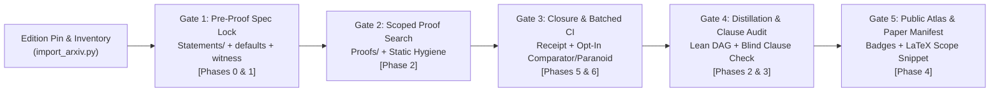

# Proof Atlas Skill Revision Plan: Addressing AI-Lean Verification Risks in Engineering & Applied Theory

**Authors / Reviewers:** Scott Moeller & Bhaskar Krishnamachari  
**Date:** November 22, 2026 *(Progress updated November 26, 2026)*  
**Original RFC Baseline:** `proof-atlas` `main` (`build-proof-atlas` v0.10.0, PRs #1, #2, #3, #6) + Open PRs [#4](https://github.com/ANRGUSC/proof-atlas/pull/4) and [#5](https://github.com/ANRGUSC/proof-atlas/pull/5)  
**Current Integration Branch (`skill-v2`):** Based on `upstream/main` (`ed1f562`, PRs #1–#8 merged) + integrated open PRs [#9](https://github.com/ANRGUSC/proof-atlas/pull/9) (`phase-2a-semantic-auditing`) and [#10](https://github.com/ANRGUSC/proof-atlas/pull/10) (`phase-2b-static-hygiene`)  
**Companion Evidence Base:** `survey-lean-proofs-eng-arxiv` (`proof-methods.md` 12-mode taxonomy + Nov 1–19, 2026 empirical survey of 3,160 arXiv preprints across `cs.DC`, `cs.NI`, `cs.IT`, `eess.SY`, `cs.CR`, `cs.RO`)

---

## Implementation Progress Tracker

| Milestone | Scope | Upstream PR(s) | Status (as of Nov 26, 2026) |
| :--- | :--- | :--- | :--- |
| **RFC Sign-Off** | Phased revision plan & baseline design decisions | [#7](https://github.com/ANRGUSC/proof-atlas/pull/7) | **Merged** (`upstream/main`) |
| **Phase 0** | Hypothesis witnesses (`--witness`), default-value scan (`defaults`), engineering totalizations (`ENNReal`, `Matrix.inv`, `condExp`, `invFun`), non-degenerate witness guidance, witness preferences & per-finding default assessments | [#4](https://github.com/ANRGUSC/proof-atlas/pull/4), [#5](https://github.com/ANRGUSC/proof-atlas/pull/5) | **Merged** (`upstream/main`) |
| **Phase 1** | Pre-proof Gate 1 spec-lock (`audit_lean.py --statement-only`), pre-closure correspondence & review carryover, author choice on pre-proof ambiguities | [#8](https://github.com/ANRGUSC/proof-atlas/pull/8) | **Merged** (`upstream/main`) |
| **Phase 2a** | Clause-enumerated blind comparison (`C1, C2, …`), skeptical-referee subagent guidance, `weaker conclusion` kind (cannot match), `noncomputable` + `pp.notation false` + `external_packages` + `axiom_profile` metadata, Mathlib-first & bridging-lemma rule | [#9](https://github.com/ANRGUSC/proof-atlas/pull/9) | **Open upstream · Integrated on `skill-v2`** |
| **Phase 2b** | Pre-build static hygiene scanner blocking metaprogramming/escape hatches (`unsafe`, `@[implemented_by]`/`@[extern]`/`@[csimp]`, `#eval`, `run_cmd`, `elab`/`macro`) and custom notation in `Statements/` | [#10](https://github.com/ANRGUSC/proof-atlas/pull/10) | **Open upstream · Integrated on `skill-v2`** |
| **Pilot Validation** | Dogfood Phases 0–2 (`skill-v2`) on `markov-block-hierarchy-proof-atlas` + compact surveyed `eess.SY`/`cs.IT` paper | — | **Next** |
| **Phase 4** | Headline-vs.-supporting claim rollup + `atlas.py manifest` LaTeX/MD scope generator | — | **Not started** (P1/P2) |
| **Phase 3** | Kernel-extracted claim DAG edges (`used_local_theorems`), `lamport` provenance (`basis`), size metrics & distillation pass | — | **Not started** (P2) |
| **Phase 5** | Opt-in `"paranoid"` multi-kernel / `Comparator` / `lean4checker` GitHub CI tier | — | **Not started** (P2) |
| **Phase 6** | Batched package build & verification (`audit_batch`) in `verify_ci.py` | — | **Not started** (P2) |

---

## Purpose of This Document

This document synthesizes:
1. **Community postmortems and best-practice proposals** for AI-assisted Lean 4 formalizations (`proof-methods.md`: 12 failure modes across semantic, adversarial/kernel, and structural layers; 4 authoring paradigms; 5 verification gates), and
2. **Real-world empirical findings** from our three-week arXiv engineering pilot (`3,160` preprints screened $\rightarrow$ `20` confirmed Lean-contributing papers, `11` in `engineering_math_proof`, and `8` deep theorem-by-theorem Layer-A audits),

and translates them into a **phased revision plan for `build-proof-atlas`**. It is structured as a design RFC so we can review trade-offs, push back on unnecessary complexity, and agree on phase ordering before changing skill instructions or scripts.

*(Note: This planning document lives in `docs/` rather than `build-proof-atlas/` so it does not inflate the context window of coding agents that install the portable skill directory.)*

---

## 1. Strategic Positioning: Why Proof Atlas Matters in the 2026 Landscape

Recent high-profile failures of bulk AI-generated Lean releases—most notably natural-language-to-Lean proof drift in *Navier–Stokes Lost in Translation* (Bastounis et al., arXiv:2610.08144), headline-to-certificate scope erasure across `openai/math`, emergent notation-hijacking in 100-agent proving swarms (Paglieri et al., arXiv:2609.04170), Lean C++ kernel soundness Bug #14576, and 13M–50M+ LoC machine proofs incurring severe conceptual debt (Cohn, Sep 2026)—have shown that **a compiling `lake build` does not guarantee that a paper's claims are true, faithful, or intelligible**.

At the same time, our empirical survey of 3,160 November 2026 engineering and applied-theory preprints reveals how researchers in control (`eess.SY`), information and coding theory (`cs.IT`), distributed systems (`cs.DC`), and cryptography (`cs.CR`) are *actually* working:

| Empirical Dimension (Nov 1–19, 2026 arXiv Pilot) | Observed Distribution | Strategic Takeaway for Proof Atlas |
| :--- | :--- | :--- |
| **Lean vs. Traditional Formal Tools** | **20** Lean papers (0.63%) vs. **12** non-Lean FV tools combined (0.38%); **6/6** formal papers in `cs.IT` use Lean | Lean is rapidly becoming the default formal tool for *engineering mathematics*, distinct from TLA+/Coq/PRISM in software/protocol FV. |
| **Authoring Paradigm** | **`P1` Paper-First Post-Hoc: 80% (16/20)** · `P4` Spec-Lock (`comparator`): 10% (2/20) · `P0` Opaque: 10% (2/20) · **`P2` Lean-First: 0%** · **`P3` Blueprint Sync (`LeanArchitect`/`Verso`): 0%** | Requiring engineering authors to abandon standard LaTeX drafting for `Verso` or `@[blueprint]` (`P3`) misses 80–90% of real users; pure Lean-first (`P2`) mirrors machine bloat into prose. |
| **AI Prover Involvement** | **80% (16/20)** explicitly disclose AI agents (`Claude Opus 5.5`, `ChatGPT-6 Astra`, `GPT-6.1 Sol`, `Codex`, `Harmonic`); **0%** claim human-only | Proof Atlas must assume the prover is an autonomous LLM optimizing for tactic closure, not a human Mathlib contributor. |
| **Codebase Scale (`Mode #10`)** | Bimodal across 13 cloned repos: **5 compact** (`528–2,191` LoC) vs. **8 massive AI repos** (`29,967–929,448` LoC; `1.85M` LoC total) | Tooling, CI workflows, and reader views must survive 50k–250k+ LoC proof packages without timing out or drowning human reviewers. |
| **Reproducible CI (`Mode #12`)** | **0 / 13** cloned paper repos configured GitHub Actions CI (`ci=[]`); 3/20 papers gave no repo URL; 2 lacked `lakefile`/`lean-toolchain` | Proof Atlas's `verify-lean.yml` + public verification receipts already put it ahead of 100% of surveyed repositories on process provenance. |

### Core Thesis: "`P1` Input Ergonomics, `P4` Spec-Lock & Audit Guarantees"

Proof Atlas should **not** force authors into Lean-first prose (`P2`) or literate LaTeX macros (`P3`). Its sweet spot is accepting an ordinary LaTeX/arXiv manuscript (`P1` ergonomics) while enforcing a **`P4` (`Spec-Lock → AI-Solve → Distill & Audit`)** workflow underneath: pinning independent statements before tactic search, auditing semantic fidelity with blind cross-checks and domain-aware static analysis, verifying proofs in isolated CI, and exporting honest scope records back to both web readers and the manuscript itself.

---

## 2. Risk Synthesis: Literature Taxonomy vs. Real Engineering Papers

Not all 12 failure modes from `proof-methods.md` manifest equally in engineering research. Our Phase 2 adversarial Layer-A audit of all 8 locally cloned `engineering_math_proof` repositories (`2611.18220` SysID, `2611.10902` EV charging, `2611.11713` Belief Propagation, `2611.08172` AG codes, `2611.14475` Explicit RIP, `2611.05136` Lattice AFT, `2611.04876` Matrix Refreshing, `2611.23762` qLDPC CCZ) separates theoretical hazards from recurring real-world gaps:

### Layer A — Semantic & Statement-Level Fidelity ("What Was Actually Proved?")

1. **Mode #1 — Statement, Hypothesis & Conjunct Drift:**
   - *Literature risk:* Type (i) autoformalization silently strengthens hypotheses (e.g., 5 derivatives instead of 4 in Navier–Stokes Lemma 8.6) or weakens bounds (extra constant dependence $A_R$ in Lemma 10.5).
   - *Survey reality:* Independent engineering authors avoided blatant hypothesis cheating (`7/8 minor_disclosed`, `1/8 minor_undisclosed`), **but** our audit caught a subtle **undisclosed conjunct drop inside a flagship `P4` `comparator` repo (`2611.04876`)**: `Compiler.Direct.directPrivacyClaim` omitted the standalone evaluation-correctness equality conjunct ("correctly evaluates every NAND circuit") and binary-rate conversion from the audited public challenge statement, even though exact correctness was proved internally in `Proofs/`. *Lesson: freezing `Statements/` is necessary but insufficient unless every paper clause is systematically accounted for.*
2. **Mode #2 — The Universal Engineering Scope Boundary & Scope-Note Erasure:**
   - *Survey reality (`8/8` papers!):* **Every single audited engineering paper** exhibited a sharp boundary between *mathematical core* (formalized) and *algorithmic/computational claims* (omitted or idealized):
     - `2611.14475` (Explicit RIP): proves matrices exist with $k = m^{2/3-o(1)}$, but marks `KM.choleskyMatrix` `noncomputable` and omits the polynomial-time complexity proof for "explicit".
     - `2611.10902` (EV charging, `eess.SY`): proves Theorems 1–3, strong duality, and $K=2$ exact-oracle optimality, omitting $K=1$, $K>2$, iterative bisection tolerances $\varepsilon,\delta$, and $O(n \log n \log(L/\varepsilon))$ runtime.
     - `2611.08172` (AG codes, `cs.IT`): proves $\mathbb{F}_{729}$ tower theorems (`noncomputable`), omitting §11 ($q \ge 512$, checked by rational scripts), Schur fullness, and closed genus formula.
     - `2611.05136` (Lattice AFT): proves Theorem 9.9 in a custom counted-op `work : ℕ` model (`Classical.choose` tables), omitting Turing-machine simulation and outer LWE/PRF/ReLU reductions.
     - `2611.11713` (Belief Propagation, `cs.IT`): proves Theorems A–C in Lean while checking the 18-vertex discriminant via external Python rational interval arithmetic.
     - `2611.23762` (qLDPC CCZ): formalizes 3 algebraic helper lemmas of a companion note and 0 theorems of the main paper.
   - *Abstract-vs.-README erasure:* Even when repo READMEs candidly listed exclusions (`2611.10902`, `2611.08172`), paper abstracts or Footnote 1 summaries frequently omitted those qualifiers.
3. **Mode #3 — Custom Definitions & Mathlib Anchoring:**
   - *Survey reality:* `0/8` malicious definition smuggling, but `4/8` relied heavily on custom domain structures (`1,291–6,431` definitions). The strongest repos (`2611.14475`, `2611.11713`, `2611.10902`, `2611.04876`, `2611.05136`) stayed trustworthy by proving **formal bridging/characterization lemmas** connecting custom wrappers to Mathlib primitives (`ripConstant_isLeast`, `fullRowRank_iff_linearIndependent`, `Vc_isGreatest`, `totalVariation_eq_half_l1`).
4. **Mode #4 — Totalized Default ("Junk") Values & Vacuous Hypotheses:**
   - *Survey reality:* `5/8` engineering repos lacked explicit non-vacuity witnesses (`example : ∃ ...`). In engineering domains (`cs.IT`, `eess.SY`), beyond `x / 0 = 0` and `ℕ` subtraction, critical traps include **`ENNReal.toReal` (`⊤.toReal = 0`**, which makes unbounded `∫⁻` expectations look bounded!), **singular matrix inversion (`A⁻¹ = 0`)**, divergent `tsum = 0`, and `sSup ∅ = 0`.

### Layer B — Adversarial & Kernel-Level Integrity ("Was It Legitimately Proved?")

5. **Mode #5 — Notation Hijacking & Specification Tampering:** Redefining `∧`, `≤`, or local notation, or mutating statement files so the proof closes trivially (DeepMind swarm study, arXiv:2609.04170).
6. **Mode #6 — Axiom Smuggling, Transitive `sorryAx`, and `native_decide`:** Custom `axiom` declarations (`2611.02057` used 7 external graph/topology axioms across 8 theorems) or `native_decide` (`Lean.ofReduceBool` / `Lean.trustCompiler`, seen in `2611.04561`), which bypasses kernel reduction and blocks external checkers.
7. **Mode #7 — Metaprogramming Bypasses & Compile-Time Side Effects:** Arbitrary host I/O during `lake build` (`#eval IO.FS...`, `run_cmd`) or environment manipulation (`Lean.addDecl`, `@[implemented_by]`, `@[csimp]`, `unsafe`).
8. **Mode #8 — Kernel Soundness Bugs & Single-Checker Monoculture:** C++ kernel bugs reachable via metaprogramming (July 2026 Collatz exploit via Bug #14576 + 6 bugs found by Selsam), mitigated in `2611.14475`, `2611.04876`, and `2611.04561` via `comparator` + `nanoda` / `lake check --paranoid` (Lean v4.35.0+ multi-kernel checking).
9. **Mode #9 — Foundational Drift (CIC Universes vs. ZFC):** Primarily relevant to set-theoretic/independence results; low risk for engineering math over `ℝ`, `ℂ`, `ℕ`, `MeasureTheory`, and finite types, provided universe polymorphism isn't abused.

### Layer C — Structural, Scale & Provenance Gaps ("Is It Usable, Maintainable Science?")

10. **Mode #10 — Proof Bloat & Type (i) Internal Drift:** 30k–929k LoC AI proofs obscure *why* a theorem holds and routinely prove main statements via routes disconnected from the paper's intermediate lemmas (`2611.05136` explicitly disclaimed internal correspondence; `2611.11713` documented alternate bounds).
11. **Mode #11 — Repo-Scale Verification Bottlenecks:** Rebuilding or running `comparator` sequentially per claim times out on 100k+ LoC repositories with dozens of claims.
12. **Mode #12 — Process Opacity & Mixed Verification Tiers:** Unpinned toolchains, missing CI, and mixing unformalized claims, partial helper lemmas, and fully verified main theorems without tier clarity.

---

## 3. Baseline Audit: What Proof Atlas Already Covers vs. Open Gaps

Recent PRs (#1, #2, #3, #6 on `main`, plus open PRs #4 and #5) have already closed several major vulnerabilities. The table below maps all 12 modes against the current codebase to isolate **net-new gaps**:

| Risk Mode | Already on `main` (`v0.10.0`) | In Open PRs ([#4](https://github.com/ANRGUSC/proof-atlas/pull/4), [#5](https://github.com/ANRGUSC/proof-atlas/pull/5)) | Remaining Gap in `build-proof-atlas` | Proposed Phase |
| :--- | :--- | :--- | :--- | :--- |
| **#1 Statement & Conjunct Drift** | PR #1: Blind two-sided readings (`--side paper` / `--side lean`), `comparisons.json` bound to `statement.sha256`, optional human approval. PR #6: `cases[].kind` difference counts. | — | 1. **`atlas.py compare` / `review` requires `status == "closed"`**, blocking pre-proof Gate 1 checks. 2. Holistic reading prompts can miss dropped conjuncts (`2611.04876` bug). | **Phases 1 & 2** |
| **#2 Scope Downgrade & Erasure** | Per-claim badges (`Subproofs checked`, `Lean proves more`, `Author’s scope note`), `manuscript-edits.json`, exact-corollary preference in `SKILL.md`. | — | 1. `KINDS` lacks `omitted conclusion` / `weaker conclusion`; `noncomputable` vs. prose "explicit/algorithm" is unflagged. 2. No headline-vs.-lemma rollup or ready-to-paste LaTeX scope paragraph to prevent abstract/footnote erasure. | **Phases 2 & 4** |
| **#3 Definition Smuggling** | `STATEMENT_QUERY` walks & hashes all local package constants reachable from `expected` (equivalent to *Lean Atlas* / `Compass` $R \cup A$ pruning!) and displays their source lines in review. | — | 1. No Mathlib-first or bridging-lemma rule in `SKILL.md`. 2. Non-Mathlib external git packages in `lake-manifest.json` aren't highlighted in receipts. | **Phase 2** |
| **#4 Junk Values & Vacuity** | — | **PR #4:** `--witness` derives & checks `∃ x…, H₁ ∧ … ∧ Hₖ` (including guarded clauses). **PR #5:** `defaults` scans 17 totalized ops (`/`, `⁻¹`, `ℕ -`, `log`, `sqrt`, `sInf`/`sSup`, `limUnder`, `tsum`, `integral`, `deriv`). | 1. Missing **`ENNReal.toReal` (`⊤ ↦ 0`)** & **singular `Matrix.inv` (`A⁻¹ ↦ 0`)**—high-frequency traps in `cs.IT` / `eess.SY`. 2. Trivial/empty witness inhabitants (`∅`, `0`) pass `--witness` without testing the non-degenerate regime. | **Phase 0** |
| **#5 Notation & Spec Tampering** | PR #2: `audit_lean.py --statements Statements` enforces that `Statements/` cannot import `Proofs/` and checks pre/post input SHA-256 hashes. | — | Custom `notation`/`macro`/`scoped notation` inside `Statements/` can make raw source lines in `exact_sources` look standard while elaborating differently; kernel-unfolded (`pp.notation false`) types aren't shown. | **Phase 2** |
| **#6 Axioms, `sorryAx` & `native_decide`** | `audit_lean.py` runs `#print axioms` and rejects anything outside `{propext, Classical.choice, Quot.sound}` (catching `sorryAx`, custom `axiom`, and honest `Lean.ofReduceBool` / `native_decide`). | PR #4 also checks `#print axioms` on `--witness`. | Constructive (0-axiom) vs. classical axiom profiles aren't surfaced in badges/receipts. *(Non-Lean computational scripts stay explicitly outside Lean scope rather than being verified by Proof Atlas.)* | **Phase 2** |
| **#7 Metaprog & Host Side Effects** | `module_inputs` rejects `lakefile.lean` (requiring declarative `lakefile.toml`), custom `srcDir`, and `LEAN_PATH`. PR #3 discloses honest-agent trust model. | — | No static scan for `unsafe`, `@[implemented_by]`, `@[extern]`, `@[csimp]`, `#eval`, `run_cmd`, or custom elaborators in `Statements/` or `Proofs/`. | **Phase 2** |
| **#8 Kernel Bugs & Monoculture** | PR #3 explicitly recommends Lean FRO `Comparator` when proofs are untrusted. | — | No turnkey opt-in `Comparator` / `lean4checker` / `lake check --paranoid` (multi-kernel) step in `verify-lean.yml` despite already having the `Statements/` vs. `Proofs/` split! | **Phase 5** |
| **#9 Foundational Drift** | Toolchain & manifest git SHA pinned in every receipt. | — | Minor note in `correspondence.md` for set-theoretic/logic claims suffices. | **Phase 2** |
| **#10 Proof Bloat & Type (i) Drift** | PR #3 labels Plain English & Lamport views *"Explanation, not machine-checked"* and notes Lean's proof may take a different route. | — | 1. Dependency graph & Lamport view don't indicate whether a paper prerequisite is *actually used* in the Lean proof term. 2. No post-closure distillation pass or proof-bloat metrics in receipts. | **Phase 3** |
| **#11 Verification Bottlenecks** | Scoped `module-closure` targets via `lake query +M:transImports`; selective Mathlib cache fetch (`--mathlib-module`). | — | `verify_ci.py` loops over closed claims and re-runs `audit()` (`lake --no-cache build`) sequentially per claim—bottlenecking 30–80 claim / 100k+ LoC repos. | **Phase 6** |
| **#12 Process Opacity** | Edition SHA-256 binding, `verify-lean.yml`, public `lean-verification.json`, explicit badge legend on homepage and `README.md`. | — | Paper PDF / arXiv abstract can still drift from Atlas reality unless the skill generates a synchronized manuscript verification statement. | **Phase 4** |

---

## 4. Proposed Phased Revision Plan

Each phase is scoped to be an independent, backward-compatible PR (preserving older atlases with graceful build warnings, following the exact pattern established in PRs #2, #4, #5, and #6).

---

### Phase 0: Land PRs #4 & #5 + Engineering Totalization & Non-Degenerate Witness Follow-Up

- **Goal:** Establish comprehensive `Mode #4` (junk-value and vacuity) protection tailored to engineering mathematics (`cs.IT`, `eess.SY`, `math.OC`, `eess.SP`).
- **Context:** PR [#4](https://github.com/ANRGUSC/proof-atlas/pull/4) (`--witness`) and PR [#5](https://github.com/ANRGUSC/proof-atlas/pull/5) (`defaults`) are both clean against `main`, though merging the first will create a small, mechanical merge conflict in `build-proof-atlas/SKILL.md` and `statement_record()` in `build-proof-atlas/scripts/audit_lean.py` for the second.
- **Proposed Additions (Phase 0b follow-up PR after #4 and #5 merge):**
  1. **Engineering-math totalization additions to `DEFAULT_VALUES` (`audit_lean.py`):**
     - `ENNReal.toReal` (*"`⊤.toReal = 0` — an infinite expectation, divergence, or `∫⁻` integral maps silently to `0`"*): critical for information theory and stochastic control (`2611.18220`).
     - `ENNReal.ofReal` (*"`ofReal x = 0` when `x ≤ 0`"*).
     - `Ring.inverse` / matrix `Inv.inv` annotations (*"singular matrix `A⁻¹` evaluates to a default (`0`) without invertibility"*): critical for control, estimation, and coding theory.
     - `ProbabilityTheory.condExp` (*"`0` when not integrable or on non-σ-finite measures"*) and `Nat.find` / `Function.invFun`.
  2. **Non-Degenerate Witness Guidance (`SKILL.md`, `correspondence.md`, `review-inputs`):**
     - Update **Show the hypotheses can hold** in `SKILL.md` to require that `--witness` instantiate a **non-degenerate case** when the paper's regime is nontrivial (e.g., nonempty index set/graph, positive dimension/block length, nonzero channel/signal) rather than satisfying universal binders purely via `Empty`, `∅`, or `0`.
     - Include the witness declaration's source snippet in `atlas.py review-inputs PROJECT CLAIM --side lean` so the blind Lean reader (and human reviewer) can verify that the witness is non-trivial.
- **Backward Compatibility:** Non-blocking warnings only, identical to PRs #4 and #5.

---

### Phase 1: True Pre-Proof Spec-Lock (`Gate 1` — Statement-Only Audit & Early Correspondence)

- **Goal:** Unlock true `Paradigm 4` (`Spec-Lock → AI-Solve`) inside Proof Atlas so statements can be fingerprinted, scanned for default-value traps, blind-compared against the paper, and optionally author-approved **before** spending hours of AI compute proving the wrong statement.
- **Current Bottleneck:** `SKILL.md` (line 18) and `references/correspondence.md` (line 3) instruct the agent to run the independent correspondence workflow *"at statement preparation and again on checked evidence"*, **but** `atlas.py` (`current_audit`) and `author_review.py` (`get_packet`, `save_comparison`) currently hard-require `work[cid]["status"] == "closed"`. On a multi-hour theorem, the agent cannot run `atlas.py review-inputs`, `atlas.py compare`, or present the statement in `review.html` until the entire proof is finished.
- **Proposed Changes:**
  1. **`audit_lean.py --statement-only`:** Check `Statements/` independence (`check_statements`), compute `statement` (`STATEMENT_QUERY`) and `defaults` (and check `--witness` if already supplied), and emit a statement receipt *without* requiring a proof `<declaration>` or building `Proofs/`.
  2. **Pre-Closure Comparison & Review (`author_review.py`, `atlas.py`, `review_web.py`, `SKILL.md`):**
     - Make `Gate 1` (`--statement-only` + blind `correspondence.md`) a **required agent step** for every inventoried paper claim (public `Statements/` targets, not internal `Proofs/` helpers) before launching proof search, while keeping human author approval optional and non-blocking.
     - Allow `drafted` / `attempted` claims that attach a statement receipt (`statement.sha256`) to run `review-inputs`, `compare`, and appear in the local review queue labeled clearly as **Statement drafted (proof in progress)**.
     - **Let the author choose when to resolve an ambiguity.** If Gate 1 returns `difference` or `unsure` with `actor: "Author"`, record the specific mathematical question in the review queue. During an interactive session, show the paper passage and the Lean statement side by side and ask, “Would you like to work through this now, or save the question and continue with independent claims?” If the author chooses to work through it now, pause and help resolve the question before resuming proof search. If the author defers it or is away, keep the affected claim and any claims that depend on the answer on hold, and continue with independent work. Return to deferred questions before the final summary and list any that still need an answer.
     - **Zero-rework payoff:** Because `STATEMENT_QUERY` intentionally strips theorem proof bodies from `statement.sha256`, any blind comparison (`comparisons.json`) or human statement approval (`reviews.json`) recorded at `Gate 1` **remains valid and carries over automatically** when the proof closes at `Gate 3`, *provided `Statements/` was not altered during proof search*. If the prover *did* alter `Statements/`, `statement.sha256` changes and automatically triggers re-comparison—catching Type (i) drift red-handed.
- **Effort / Risk:** Low–Medium (~80–120 LoC in `audit_lean.py` + `author_review.py`). Fully backward-compatible.

---

### Phase 2: Clause-Complete Semantic Auditing, Strict Scope Tracking & Static Hygiene (`Layer A` + `Layer B` Fast Checks)

- **Goal:** Prevent silent conjunct drops (`2611.04876`), strictly track and highlight unproven algorithmic/runtime obligations (`8/8` engineering papers), harden custom-definition review, and add fast static metaprogramming/notation hygiene in `audit_lean.py` (`Modes #1–#3, #5–#7`).
- **Proposed Changes:**
  1. **Clause-Enumerated Blind Comparison & Separate Auditor Context (`references/correspondence.md`):**
     - Require the blind `--side paper` reader to output an explicit **numbered inventory of paper obligations** (each quantifier, hypothesis, and conclusion conjunct `C1, C2, ...`) *before* seeing Lean. During comparison, every `Ci` must map to a named clause in the Lean reading or become its own `cases` row—eliminating holistic-summary blind spots like `2611.04876`'s missing compiler-correctness conjunct.
     - Explicitly instruct multi-agent hosts to run the comparison coordinator in a **fresh subagent context** prompted as a skeptical referee (ProofBridge / DeepMind red-team separation) rather than reusing the prover's context.
  2. **Engineering Scope Kinds, Open Algorithmic Obligations & `noncomputable` Detection (`author_review.py`, `audit_lean.py`, `atlas.py`, `correspondence.md`):**
     - Expand `author_review.KINDS` (`agrees`, `added hypothesis`, `restriction`, `chosen reading`, `other form`, `stronger`) to add **`weaker conclusion`** (covering coarser constants like `2611.08172`/`2611.11713`, omitted conjuncts like `2611.04876`/`2611.23762`, and omitted runtime/tolerance bounds like `2611.10902`/`2611.14475`).
     - **Strict closure policy for unproven clauses:** Both missing mathematical conjuncts and unproven algorithmic/runtime/explicitness clauses must be recorded explicitly as open obligations in the status database (`work[cid].subproofs` / comparison differences), highlighted visibly in Proof Atlas, and **leave the parent claim open** (e.g., `Subproofs checked` rather than `"closed"`) unless actually proved.
     - In `STATEMENT_QUERY`, record whether each package constant in `statement.constants` is marked `noncomputable` (`Lean.isNoncomputable env n`). Update `correspondence.md` so that if a paper claim says *"explicit"*, *"algorithm"*, *"computable"*, or states a runtime bound while the Lean definition is `noncomputable`, the comparison must surface that gap explicitly (`2611.14475`, `2611.08172`).
  3. **Mathlib-First Rule, Bridging Lemmas & Notation-Unfolded Signatures (`SKILL.md`, `audit_lean.py`):**
     - Add a **Mathlib-First & Bridging-Lemma Rule** to `SKILL.md`: use upstream Mathlib structures wherever practical; when domain ergonomics justify a custom definition (e.g., `IsIdentifiable`, `ripConstant`, `FiniteDist`), prove a short equivalence or characterization lemma in `Statements/` connecting it to standard primitives where one exists.
     - Record external dependencies from `lake-manifest.json` in the audit receipt, flagging any non-Mathlib third-party git repository in the Lean view and review page so reviewers notice external theories (e.g., `riemann-roch-function-fields` in `2611.08172` or `TauCeti` in `2611.11713`).
     - Have `STATEMENT_QUERY` also emit Lean's pretty-printed signature with custom notation disabled (`set_option pp.notation false`) alongside raw file lines in `exact_sources` as defense-in-depth for human and LLM readers.
  4. **Static Metaprogramming, Custom-Notation & Escape-Hatch Scanner (`audit_lean.py`, `SKILL.md`):** *(Pulled forward from Phase 5 because it touches the same `audit_lean.py` pipeline with minimal extra scope.)*
     - Scan all `checked_inputs` `.lean` files (after comment/string stripping) for high-risk directives:
       - **Hard error in `Statements/`:** `unsafe`, `@[implemented_by]`, `@[extern]`, `@[csimp]`, `#eval`, `run_cmd`, `elab`, `elab_rules`, `macro`, `macro_rules`, and custom `notation`, `local notation`, `scoped notation`, `infix`, `prefix`, `postfix` (upstream Mathlib notation imported by `Statements/` continues to work normally).
       - **Hard error or explicit flag in `Proofs/`:** `unsafe`, `@[implemented_by]`, `@[extern]`, `@[csimp]`, `#eval`, `run_cmd`, custom `elab`/`macro` environment mutations.
     - Record exact axiom profile in badges/receipts (`constructive / 0 axioms` vs. `standard classical axioms`). Keep `native_decide` (`Lean.ofReduceBool`) rejected by default; guide agents in `SKILL.md` toward kernel-checked `decide` / `bv_decide` / `norm_num` first.

---

### Phase 3: Proof-Graph Grounding & Post-Closure Distillation (`Layer C` — Mode #10)

- **Goal:** Make Type (i) vs. Type (ii) proof correspondence transparent to readers and curb multi-hundred-thousand-line AI proof debt without sacrificing discovery speed.
- **Current Gap:** In `reader.json`, dependency arrows (`Lemma 7 → Theorem 8`) come from manuscript `\ref` citations, while `Plain English` and `Lamport proof` views have no explicit provenance tag indicating whether they follow the *manuscript's* proof or *Lean's* proof. In bloated AI repos (`2611.05136`, `2611.11713`), Lean often proves a theorem via a completely different route without using the Lean formalization of the paper's intermediate lemma.
- **Proposed Changes:**
  1. **Kernel-Extracted Claim Dependency Verification (`audit_lean.py`, `atlas.py`, `graph.js`):**
     - During `audit_lean.py`, walk the proof declaration's transitive local constant closure (`env.find?`) and list all local package `thmInfo` constants used (`used_local_theorems`, or check against other audited `declaration` names in `project.json`).
     - In `atlas.py`, cross-reference `reader.json` `dependencies` against `used_local_theorems`: distinguish **Used in both paper & Lean proof**, **Paper-only dependency (Lean proved independently)**, and **Lean-only prerequisite** in the Dependency Graph / Lean tab.
  2. **Structured-Proof Provenance & Distillation Pass (`SKILL.md`, `atlas.py`):**
     - Add a one-field `basis` (`"paper"`, `"lean"`, or `"aligned"`) on `lamport` / `sketch` entries so readers know whether the structured steps explain the paper's argument or the formal proof's architecture.
     - Record lightweight size metrics in each closure receipt (`reachable_local_defs`, `reachable_local_theorems`, `checked_lean_loc`).
     - Add a **Post-Closure Distillation Step** in `SKILL.md`: once an exploratory proof compiles, remove dead scratch declarations, factor repeated tactic blocks into named helper lemmas, and derive an exact paper-statement corollary before running final closure—treating the raw AI tactic search as a draft rather than the finished artifact (Cohn's principle).

---

### Phase 4: Anti-Scope-Erasure & Paper-Side Verification Manifest (`Layer A/C` — Modes #2 & #12)

- **Goal:** Prevent scope qualifiers from vanishing between the Proof Atlas website and the arXiv PDF (`2611.10902` Footnote 1, `2611.08172` abstract, `2611.23762` headline mismatch), while keeping Proof Atlas strictly focused on Lean formalization + prose (no non-Lean script verification or reproducibility scope creep).
- **Proposed Changes:**
  1. **Headline vs. Supporting Result Breakdown (`atlas.py`, `explorer.html`):**
     - Allow `project.json` (or `reader.json`) to mark primary/headline claims (defaulting to `theorem` / `corollary` vs. supporting `lemma` / `proposition` + separate `conjecture`), and surface that breakdown on the Folio overview and dashboard (*e.g., "3/3 Theorems and 7/7 Lemmas closed; 1 open conjecture"* vs. *"0/4 Theorems closed; 3/12 supporting Lemmas closed"*).
     - Highlight claims that remain open due to unproven algorithmic/runtime or other omitted obligations (from Phase 2) separately from completely untouched claims so readers immediately see what is Lean-proved vs. still open.
  2. **`atlas.py manifest PROJECT` — Ready-to-Paste LaTeX & Markdown Verification Summary:**
     - Add a deterministic subcommand that generates both `dist/VERIFICATION.md` and a concise LaTeX `\paragraph{Formal Verification and Scope.}` snippet summarizing:
       - Exact counts of closed vs. open/unformalized claims by kind,
       - Every active non-`agrees` scope boundary from `comparisons.json` (`restriction`, `added hypothesis`, `weaker conclusion`, `noncomputable` idealizations) and open algorithmic/runtime obligations,
       - Pinned `lean-toolchain`, Mathlib commit SHA, axioms used, `Statements/` digest, and GitHub verification URL.
     - Update `SKILL.md` so that if the imported manuscript's abstract/introduction/footnote already contains a Lean verification claim whose scope disagrees with the Atlas inventory, the agent proposes a `manuscript-edits.json` item using this generated manifest.

---

### Phase 5: Opt-In Multi-Kernel / `Comparator` CI (`Layer B` — Mode #8)

- **Goal:** Provide an opt-in cryptographic/adversarial CI tier (`Comparator` / `lean4checker` / `lake check --paranoid`) on GitHub without slowing everyday iteration. *(Fast static escape-hatch and notation hygiene runs locally in `audit_lean.py` starting in Phase 2.)*
- **Proposed Changes:**
  - Because PR #2 *already* isolates `Statements/` from `Proofs/`, Proof Atlas is one step away from native `Comparator` / external-kernel replay.
  - Add an optional `hosting.lean_ci_level` (`"standard"` default vs. `"paranoid"`) across `hosting.py`, `verify_ci.py`, and `references/verify-lean.yml`:
    - **`standard` (current):** Rebuilds and runs `audit_lean.py` on GitHub Actions (`Machine verified on GitHub`).
    - **`paranoid` (opt-in for flagship releases):** Runs in a network-disabled container step after Mathlib cache fetch, replays exported declarations through `lean4checker --fresh` and/or `Comparator` (and `lake check --paranoid` multi-kernel checking when the pinned toolchain is Lean $\ge$ v4.35.0, matching `2611.14475` and `2611.04876`), and records `kernels_checked` in `lean-verification.json`.

---

### Phase 6: Batched Verification for Large AI Repositories (`Layer C` — Mode #11)

- **Goal:** Ensure `verify_ci.py` and local re-audits scale cleanly to 50k–250k+ LoC repositories with 30–80 closed claims (`2611.08172`, `2611.02057`, `2611.04876`) well inside GitHub Actions' 150-minute job window.
- **Current Bottleneck:** `verify_ci.py` (lines 52–60) iterates over every closed claim in a package and invokes `audit()` individually, triggering a separate `lake --no-cache build` subprocess and separate Lean environment startups per claim.
- **Proposed Changes:**
  - Add a **batched package verification path** (`audit_batch` in `audit_lean.py`, used by `verify_ci.py`):
    1. Verify `module_inputs` and pre-build SHA-256 input closures for every closed claim up front,
    2. Run **one** `lake --no-cache build <union-of-targets>` per Lean package,
    3. Execute per-contract type/witness/axiom/statement checks against the freshly built `.olean` artifacts, and
    4. Re-verify post-check input closures and emit identical per-claim records in `lean-verification.json`.
- **Impact:** Eliminates redundant Lake graph walks and compilation across shared prerequisites, cutting multi-claim CI latency dramatically with zero reduction in audit rigor.

---

## 5. Summary Prioritization & Effort Matrix

| Phase | Focus | Primary Layers / Modes | Touches | Est. Scope | Recommended Priority | Status |
| :--- | :--- | :--- | :--- | :--- | :--- | :--- |
| **Phase 0** | Merge PRs #4 & #5 + `ENNReal.toReal`/`Matrix.inv` defaults + non-degenerate witness rule | Layer A (`Mode #4`) | `audit_lean.py`, `SKILL.md`, `correspondence.md`, `atlas.py` | Small | **Immediate (P0)** | **Merged** ([#4](https://github.com/ANRGUSC/proof-atlas/pull/4), [#5](https://github.com/ANRGUSC/proof-atlas/pull/5)) |
| **Phase 1** | Pre-proof `Gate 1` (`--statement-only` + pre-closure `compare` & `review`, author chooses when to resolve ambiguities) | Layer A (`Mode #1`), `P1 → P4` | `audit_lean.py`, `author_review.py`, `atlas.py`, `review_web.py`, `SKILL.md` | Medium | **High (P1)** | **Merged** ([#8](https://github.com/ANRGUSC/proof-atlas/pull/8)) |
| **Phase 2** | Clause-enumerated blind diff, `weaker conclusion` kind + open algorithmic obligations, `noncomputable` & external-pkg flags, `pp.notation false`, Mathlib bridging rule, static escape-hatch & custom-notation ban | Layer A (`Modes #1, #2, #3`), Layer B (`Modes #5, #6, #7`) | `correspondence.md`, `SKILL.md`, `author_review.py`, `audit_lean.py`, `atlas.py` | Medium | **High (P1)** | **Open upstream · on `skill-v2`** ([#9](https://github.com/ANRGUSC/proof-atlas/pull/9), [#10](https://github.com/ANRGUSC/proof-atlas/pull/10)) |
| **Phase 4** | Headline-vs.-lemma rollup + `atlas.py manifest` LaTeX/MD scope generator (Lean + prose only) | Layer A/C (`Modes #2, #12`) | `atlas.py`, `explorer.html`, `SKILL.md` | Small–Med | **High (P1/P2)** | **Not started** |
| **Phase 3** | Kernel-extracted claim DAG edges + `lamport` provenance + distillation pass | Layer C (`Mode #10`), Type (i)/(ii) | `audit_lean.py`, `atlas.py`, `graph.js`, `SKILL.md` | Medium | **Medium (P2)** | **Not started** |
| **Phase 5** | Opt-in `paranoid` (`Comparator`/multi-kernel) GitHub CI tier | Layer B (`Mode #8`) | `hosting.py`, `verify_ci.py`, `verify-lean.yml` | Med–Large | **Medium (P2)** | **Not started** |
| **Phase 6** | Batched package build & verification in `verify_ci.py` | Layer C (`Mode #11`) | `audit_lean.py`, `verify_ci.py` | Small–Med | **Medium (P2 — before first >50k LoC atlas)** | **Not started** |

---

## 6. Baseline Design Decisions (For Co-Author Sign-Off)

The six design choices from the initial draft have been resolved as the proposed baseline below (open to pushback during PR #7 review):

1. **Gate 1 pre-proof workflow and author choice (Phase 1)**
   `SKILL.md` will require the agent to run `audit_lean.py --statement-only` and the blind `correspondence.md` check on every inventoried paper claim (`Statements/` target) **before** proof search. Human approval remains optional. For a difference or uncertainty assigned to the author, offer the choice described in Phase 1: resolve the question together now, or keep it in the review queue and continue with independent claims. Use the latter as the unattended default. Resume affected work once the question is resolved, and revisit outstanding questions before the final summary.
2. **Taxonomy of Difference `KINDS` & Unproven Algorithmic Clauses (Phase 2) — Add `weaker conclusion`, Keep Unproven Clauses Open:**  
   Add **`weaker conclusion`** to `author_review.KINDS` so weaker bounds or omitted clauses are classified honestly instead of mislabeled as `restriction`. Both missing mathematical conjuncts and unproven algorithmic/runtime clauses stay explicitly tracked in the status database, highlighted in Proof Atlas, and **leave the parent claim open** (`Subproofs checked`, not `"closed"`) unless proved.
3. **Notation & Metaprogramming Restrictions in `Statements/` (Phase 2) — Hard-Ban Custom Notation + Always Show `pp.notation false`:**  
   `audit_lean.py` will hard-error on metaprogramming/escape hatches (`unsafe`, `@[implemented_by]`, `@[extern]`, `@[csimp]`, `#eval`, `run_cmd`, `elab`, `macro`) **and** custom `notation`/`infix`/`prefix`/`postfix` inside `Statements/` (upstream Mathlib notation continues to work), while still rendering Lean's `pp.notation false` unfolded expression as defense-in-depth.
4. **Non-Lean Computational Evidence (Phase 4) — Out of Scope:**  
   Proof Atlas stays focused strictly on Lean formalization + prose (no `"Computed script"` checkpoint attachment or script reproducibility/verification pipeline) to avoid scope creep.
5. **Positioning Relative to `LeanArchitect` / `Verso` Blueprints (`Paradigm 3`) — Strict Zero-LaTeX-Lock-In:**  
   Keep the LaTeX manuscript untouched by design (no required `\inputleannode` or `@[blueprint]` tags, and no `leanblueprint` importer unless explicitly requested later); verify actual Lean theorem-to-theorem usage directly from the kernel in Phase 3.
6. **Phase Ordering & Pilot Validation — Pull Static Hygiene into Phase 2, Dogfood Before Phases 3/5/6:**  
   Execute in order **Phase 0 $\rightarrow$ Phase 1 $\rightarrow$ Phase 2 (including static escape-hatch/notation scanner) $\rightarrow$ Phase 4 $\rightarrow$ Phases 3 / 5 / 6**, dogfooding Phases 0–2 on `markov-block-hierarchy-proof-atlas` plus a compact surveyed `eess.SY`/`cs.IT` paper before rolling out Phases 3, 5, and 6.
