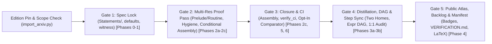

# Proof Atlas Skill Revision Plan: Addressing AI-Lean Verification Risks in Engineering & Applied Theory

**Authors / Reviewers:** Scott Moeller & Bhaskar Krishnamachari  
**Date:** November 22, 2026 *(Revised November 26, 2026: 15-category longitudinal census, `TINA` architecture synthesis, and multi-resolution workflow)*  
**Original RFC Baseline:** `proof-atlas` `main` (`build-proof-atlas` v0.10.0, PRs #1, #2, #3, #6) + PRs [#4](https://github.com/ANRGUSC/proof-atlas/pull/4) and [#5](https://github.com/ANRGUSC/proof-atlas/pull/5)  
**Current Integration Branch (`skill-v2`):** Unified feature branch based on `upstream/main` (`ed1f562`, PRs #1–#8 merged) + Phases 2a, 2b, 2c, 3a, 3b, 4, Pilot Validation, Phase 5, and Phase 6 implemented directly on `skill-v2`  
**Companion Evidence Base:**
1. [`survey-lean-proofs-eng-arxiv`](https://github.com/electronjoe/survey-lean-proofs-eng-arxiv) (*How Are Engineering Papers Adopting Lean?*, Moeller & Krishnamachari, Nov 25, 2026: 12-mode failure taxonomy in `docs/proof-methods.md` + 15-category longitudinal census of **12,613** arXiv preprints across Nov 2025, May 2026, and Nov 2026 $\rightarrow$ **82** confirmed Lean papers, **27** Layer-A semantic audits, **23** offline clean-room Docker builds, and authoring-paradigm best practices).
2. [`ANRGUSC/TINA`](https://github.com/ANRGUSC/TINA) (`papers/arxiv-v3/lean`, package `TinaV2`, moved from `papers/arxiv-v2/lean` on Nov 18, 2026: **34** verified claims / **162** `Expr`-audited step and main lemmas in **9,227** non-empty LoC, evaluated side-by-side against the surveyed `P4` cohort).

---

## Implementation Progress Tracker

| Milestone | Scope | Upstream PR(s) | Status (as of Nov 26, 2026) |
| :--- | :--- | :--- | :--- |
| **RFC Sign-Off** | Phased revision plan & baseline design decisions | [#7](https://github.com/ANRGUSC/proof-atlas/pull/7) | **Merged** (`upstream/main`) · *Rev 2 updated on `skill-v2`* |
| **Phase 0** | Hypothesis witnesses (`--witness`), default-value scan (`defaults`), engineering totalizations (`ENNReal`, `Matrix.inv`, `condExp`, `invFun`), non-degenerate witness guidance, witness preferences & per-finding default assessments | [#4](https://github.com/ANRGUSC/proof-atlas/pull/4), [#5](https://github.com/ANRGUSC/proof-atlas/pull/5) | **Merged** (`upstream/main`) |
| **Phase 1** | Pre-proof Gate 1 spec-lock (`audit_lean.py --statement-only`), pre-closure correspondence & review carryover, author choice on pre-proof ambiguities | [#8](https://github.com/ANRGUSC/proof-atlas/pull/8) | **Merged** (`upstream/main`) |
| **Phase 2a** | Clause-enumerated blind comparison (`C1, C2, …`), skeptical-referee subagent guidance, `weaker conclusion` kind (cannot match), `noncomputable` + `pp.notation false` + `external_packages` + `axiom_profile` metadata, Mathlib-first & bridging-lemma rule | [#9](https://github.com/ANRGUSC/proof-atlas/pull/9) | **Completed on `skill-v2`** |
| **Phase 2b** | Pre-build static hygiene scanner blocking metaprogramming/escape hatches (`unsafe`, `@[implemented_by]`/`@[extern]`/`@[csimp]`, `#eval`, `run_cmd`, `elab`/`macro`) and custom notation in `Statements/` | [#10](https://github.com/ANRGUSC/proof-atlas/pull/10) | **Completed on `skill-v2`** |
| **Phase 2c** *(New)* | Multi-resolution workflow (`quick` hands-off vs. `thorough`), separable conditional proofs + generated `Assembly.lean` (`Conditional` badge), `Needs author confirmation` propagation, narrow `Prelude.lean` + `Routine/` + ~8-cycle stall breaker, kernel `.thmInfo` check | — *(unified `skill-v2` branch)* | **Completed on `skill-v2`** |
| **Phase 3a** | Kernel-extracted claim DAG edges (`used_local_theorems` / `.Statement` cross-referenced in `graph.js`), TINA "two homes" provenance (`paper`/`lean`/`aligned`/`supplied`, `dist/supplement.md`, `Lean checked (proof supplied outside manuscript)`), size metrics (`reachable_local_defs`, `reachable_local_theorems`, `checked_lean_loc`) & distillation pass | — *(unified `skill-v2` branch)* | **Completed on `skill-v2`** |
| **Phase 4** | Headline-vs.-supporting claim rollup, explicit shortcoming & **Refinement Backlog** disclosure, and `atlas.py manifest` LaTeX/MD scope generator | — *(unified `skill-v2` branch)* | **Completed on `skill-v2`** |
| **Pilot Validation** | Full Lean 4.33.1 integration tests (`43/43` pass) + dogfooding `skill-v2` (`quick` → `thorough`, `assemble --audit`, `manifest`, `supplement.md`, kernel DAG) on compact live-Lean paper & `markov-block-hierarchy-proof-atlas` | — *(unified `skill-v2` branch)* | **Completed on `skill-v2`** |
| **Phase 3b** | Opt-in TINA 1:1 step-lemma mirroring (`step_map` + compiled `Expr` `auditUses`) | — *(unified `skill-v2` branch)* | **Completed on `skill-v2`** |
| **Phase 5** | Full CI check parity in `verify_ci.py` + `kernels_checked`, mechanical hash-locked `Challenge.lean` / `Solution.lean` (`atlas.py challenge`), and opt-in `"paranoid"` CI (`hosting.lean_ci_level`, offline `unshare`, `Comparator` / `lean4checker` / Lean $\ge$ v4.35.0 `lake check --paranoid`) | — *(unified `skill-v2` branch)* | **Completed on `skill-v2`** |
| **Phase 6** | Batched package build & verification (`audit_batch`) in `verify_ci.py` | — *(unified `skill-v2` branch)* | **Completed on `skill-v2`** |

---

## Purpose of This Document

This document synthesizes three sources of evidence:
1. **Community postmortems and best-practice proposals** for AI-assisted Lean 4 formalizations (`proof-methods.md`: 12 failure modes across semantic, adversarial/kernel, and structural layers; 4 authoring paradigms; 5 verification gates),
2. **Longitudinal empirical findings** from [`survey-lean-proofs-eng-arxiv`](https://github.com/electronjoe/survey-lean-proofs-eng-arxiv) (`12,613` unique preprints screened across 15 engineering and applied-theory arXiv categories over Nov 2025, May 2026, and Nov 2026 $\rightarrow$ `82` confirmed Lean papers, `27` theorem-by-theorem Layer-A semantic audits, and `23` offline clean-room Docker builds), and
3. **Production lessons from [`ANRGUSC/TINA`](https://github.com/ANRGUSC/TINA)** (`papers/arxiv-v3/lean`, `TinaV2`), which formalized 34 mathematical claims with 1:1 `Expr`-verified step correspondence in just 9,227 LoC—alongside co-author design feedback on **iterative, multi-resolution adoption**,

and translates them into a **phased revision plan for `build-proof-atlas`**.

*(Note: This planning document lives in `docs/` rather than `build-proof-atlas/` so it does not inflate the context window of coding agents that install the portable skill directory.)*

---

## 1. Strategic Positioning: Empirical Reality, TINA Lessons & Multi-Resolution Design

### 1.1 What the 12,613-Paper Longitudinal Census Shows

High-profile failures of bulk AI-generated Lean releases—natural-language-to-Lean proof drift in *Navier–Stokes Lost in Translation* (Bastounis et al., arXiv:2610.08144), headline-to-certificate scope erasure across `openai/math`, emergent notation-hijacking in 100-agent proving swarms (Paglieri et al., arXiv:2609.04170), Lean C++ kernel soundness Bug #14576, and 13M–50M+ LoC machine proofs incurring severe conceptual debt (Cohn, Sep 2026)—have demonstrated that **a compiling `lake build` does not guarantee that a paper's claims are true, faithful, or intelligible**.

Our expanded 15-category longitudinal census in [`survey-lean-proofs-eng-arxiv`](https://github.com/electronjoe/survey-lean-proofs-eng-arxiv) (covering 100% of `eess.*` plus `cs.DC`, `cs.NI`, `cs.IT`, `cs.CR`, `cs.RO`, `cs.SY`, `math.OC`, and related applied-theory venues across three matched 19-day windows) establishes how engineering and applied-theory authors actually use Lean 4:

| Empirical Dimension (`survey-lean-proofs-eng-arxiv`) | Observed Longitudinal / Census Result | Strategic Takeaway for Proof Atlas |
| :--- | :--- | :--- |
| **Adoption Trajectory** | Initial-submission Lean papers surged **`0/3,164` (0.00%) $\rightarrow$ `7/4,146` (0.17%) $\rightarrow$ `68/5,303` (1.28%)** (`7.6×` in 6 months; **`82` total** / `20.59×` YoY with retroactive revisions); strict engineering algorithmic proofs jumped **`6.77×`** (`0 $\rightarrow$ 3 $\rightarrow$ 26`), while non-Lean FV stayed flat (`1.23% $\rightarrow$ 1.04%`). | Engineering math formalization in Lean is scaling exponentially, distinct from traditional TLA+/Coq/PRISM protocol verification. |
| **Authoring Paradigms (`v_latest = 82` / T2 `v1 = 68`)** | **`P1` Post-Hoc: 70.6% (`57/82`)** · **`P0` Opaque: 17.6% (`16/82`)** · **`P4` Pinned Spec: 10.3% (`7/82`)** · **`P3` Sync Blueprint: 1.5% (`1/82`; `0/31` eng.)** · **`P2` Lean-First: 0.0% in T2 (`1/82` total)** | Mandating `Verso`/`LeanArchitect` (`P3`) upfront misses ~99% of engineering authors; raw `P2` failed (`Partial/Weakened` + broken build); `P0` is `0/16` Gold. |
| **`P4` vs. Author-Led `P1` vs. Bulk `P1`** | **`P4`:** `7/7` (**100%**) Static Gold, `0/7` soundness/opacity flags, `4/4` Layer-A High/Mostly Faithful (`3/4` witnesses), *LongTails* (`2611.13872`) faithful at scale. **`P1`:** Only `54.4%` (`31/57`) Gold & `17/21` clean-room build pass—yet **`0/21` author-owned `P1` repos had material undisclosed drift**, whereas bulk autonomous `P1` (*Paper2Lean*, `2611.26272`) suffered **Material Undisclosed Drift** (`hB_lipschitz`, `hweak`, `FiniteDimensional`, `AntitoneOn`). Top `P1` repos (`2611.18455`, `2611.15201`) independently added `statement-lock.json` or `comparator`. | The survey supports a **two-tier best-practice model**: a low-friction **"Hardened `P1`"** entry ramp for fast author adoption, upgrading cleanly into **full `P4` (`Spec-Lock → AI-Solve → Distill`)**—while strictly forbidding un-audited bulk `P1` drift. |
| **AI Provers & Codebase Bloat (`Mode #10`)** | **80.9%** explicitly disclose AI provers; median paper-owned LoC grew **`46.2×`** (`749 $\rightarrow$ 34,579` LoC; **`8.14M` LoC** across 51 repos). Even among `P4` adopters, **`5/7` tripped bloat (`>20k` LoC; median `81,481` LoC, up to `697,377` LoC)** because teams skipped the *Distill* pass. | `Spec-Lock` alone does not prevent unreadable machine sprawl; structural anti-bloat (`Prelude.lean` + `Routine/` + distillation) and scalable CI are essential. |
| **Clean-Room Builds & CI (`Mode #12`)** | Offline Docker clean-room builds on compact repos (`<15k` LoC) passed **`18/23` (78.3%)** (`11/11` Gold axiom-clean), yet almost zero surveyed repos configure GitHub Actions `lake build` CI. | Proof Atlas's pinned Lake layout + `verify-lean.yml` + public receipts directly solve the 21.7% packaging failure rate and universal CI gap. |
| **Operational FV Scope Carve-Out** | Across an 8-paper audit of operational software/hardware/protocol verification (`cs.DB`, `cs.CR`, `cs.PL`), **`0/8` adopted `P2`–`P4`**. | Proof Atlas should explicitly bound its scope to **mathematical and algorithmic claims in manuscripts**, steering operational system verification toward refinement/state-machine frameworks. |

### 1.2 Core Thesis: Multi-Resolution Iterative Refinement on a Zero-Regret `P4` Foundation

As co-author Bhaskar Krishnamachari observes:
> *"There is some balance to be struck between being thorough and being realistic. Many users want a hands-off quick version, then can come back and tackle slow work over time. Each time the badges reflect what has or has not been done. So we want this kind of iterative refinement / multi-resolution approach."*

If a "quick" formalization dumps definitions and proofs into tangled files without statement locks or clause checks (raw `P1`), two bad things happen: (1) silent statement drift (*Paper2Lean*) can award green checkmarks to mutated theorems, and (2) upgrading to `P4` best practices later requires rewriting the repository from scratch.

Proof Atlas solves this by exposing **dual caller profiles—`quick` (Hands-Off Triage / Hardened-`P1` speed) and `thorough` (Full `P4 + TINA` rigor, default)**—organized as **breadth-first passes over a shared, non-negotiable structural floor**:

1. **Zero-Regret Structural Floor (enforced in BOTH `quick` and `thorough` — costs seconds, prevents rewrites):**
   - `Statements/` (`Prop` definitions, zero `sorry`) strictly isolated from `Proofs/` (`--statements Statements`),
   - Narrow `Prelude.lean` Mathlib imports (~4–5s per file check instead of ~48s `import Mathlib`) + isolated `Routine/` plumbing library,
   - Pre-build static escape-hatch and `Statements/` custom-notation ban (`scan_lean_hygiene`),
   - Pre-proof `audit_lean.py --statement-only` (`statement.sha256`, `defaults` junk-value scan, `noncomputable` & `pp.notation false` capture) + kernel `#print axioms` and `.thmInfo` verification,
   - Blind clause-enumerated `correspondence.md` check on every closed/conditional claim so silent drift is **never** awarded a badge.
   - *Why zero rework is needed later:* Because `statement.sha256` strips proof bodies and `Proofs/` are separable per claim, later proving missing witnesses, closing conditional prerequisites, distilling bloated proofs, or adding 1:1 step verification **never invalidates unchanged `Statements/`, `comparisons.json`, or `reviews.json` approvals**.

2. **How `quick` Saves Hours Without Hiding Shortcomings:**

| Dimension | `quick` (Hands-Off Triage Pass) | `thorough` (Full `P4 + Distill`, Default) | Opt-In `deep` Extensions (Phases 3b & 5) | Badge / Artifact Disclosure When Deferred |
| :--- | :--- | :--- | :--- | :--- |
| **Ambiguities in Paper** | Commits to best-supported reading as a `chosen reading` / `added hypothesis` / `restriction` difference and keeps going | Interactive choice (`work through now` vs. `save & hold dependents`); unattended holds dependents | Same as `thorough` + co-author freeze sign-off | Prominent **`Needs author confirmation`** badge + top-of-manifest caveat |
| **Hard / Stalling Proofs** | **~8-build-cycle circuit breaker**: logs obstacle & proves downstream claims **conditionally** (`(hX : X.Statement) → Y.Statement`) | Deep decomposed subproof search across all prerequisites until unconditional closure | Same as `thorough` | **`Conditional (assumes Lemma X)`** badge (never labeled unconditional `Lean checked`) |
| **Non-Vacuity Witnesses** | Defaults `witness_search = "skip"` (reusing only trivial/already-present witnesses) | `available` (or `pursue`): constructs non-degenerate `Examples/` witnesses | Full model-tier witness suite | **`No checked example shows the hypotheses can hold`** badge + backlog item |
| **Default-Value Flags** | Flagged in scan; unresolved traps marked `needs attention` without blocking | Every finding justified by hypothesis/lemma or resolved before sign-off | Same as `thorough` | **`Unresolved default-value flag (K)`** indicator on review/manifest |
| **Bridging & Distillation** | Deferred; raw tactic proofs encapsulated inside `Proofs/` | Mathlib bridging lemmas in `Statements/` + post-closure `Routine/` distillation & exact paper corollary | **TINA 1:1 step-lemma mirroring** (`step_map` + `Expr` `auditUses`) | **`Exploratory proof (undistilled)`** vs. **`Distilled`** vs. **`Step-verified (paper / supplied)`** |
| **Remote Verification** | Optional local-only or standard GitHub CI | Standard GitHub Actions `verify-lean.yml` (`Machine verified on GitHub`) | **`paranoid` CI**: generated `Challenge.lean` + `Comparator` + multi-kernel (`v4.35.0+`) | **`Local Lean check`** vs. **`✓ Machine verified on GitHub`** vs. **`✓ Multi-kernel / Comparator`** |

---

## 2. Risk Synthesis: Literature Taxonomy, Survey Audits & the `TINA` Benchmark

### 2.1 Lessons From the 12 Failure Modes Across 27 Layer-A Audits

1. **Mode #1 — Statement, Hypothesis & Conjunct Drift (Layer A):**
   - *Bulk `P1` vs. Author-Owned Repos:* Autonomous bulk `P1` pipeline *Paper2Lean* (`2611.26272`) introduced material undisclosed hypotheses (`hB_lipschitz`, `hweak`, `FiniteDimensional`, `AntitoneOn`). Author-owned engineering repos had `0/22` material undisclosed drift, **yet** flagship `P4` `comparator` repo `2611.04876` (*MatrixRefresh*) still suffered a subtle **undisclosed conjunct drop** (`Compiler.Direct.directPrivacyClaim` omitted standalone circuit-evaluation equality even though it was proved internally). *Lesson: `Statements/` isolation must be paired with clause-enumerated (`C1, C2, …`) blind auditing.*
2. **Mode #2 — Universal Algorithmic/Modeling Scope Boundaries & Scope-Note Erasure (Layer A):**
   - Across audited engineering papers, mathematical cores were formalized while algorithmic runtime/complexity (`2611.14475` `noncomputable` `KM.choleskyMatrix`, `2611.10902` bisection runtime, `2611.05136` Turing reductions), numerical certificate scripts (`2611.08172`, `2611.11713`), or SDE-to-law steps (`TINA` `C4.c`/`C9`) stayed outside Lean—and paper abstracts/footnotes routinely erased README caveats (`2611.10902`, `2611.08172`, `2611.23762`) or omitted Lean entirely (`TINA` `main-v3.tex`).
3. **Mode #3 — Custom Definitions & Mathlib Anchoring (Layer A):**
   - `0/22` malicious definition smuggling in author-led engineering repos (`4/4` clean in `P4`), with top repos proving explicit **Mathlib characterization/bridging lemmas** (`ripConstant_isLeast`, `Vc_isGreatest`, `totalVariation_eq_half_l1`, and `TINA`'s `QHilbert` / `R_eq_sigmaRegret`).
4. **Mode #4 — Totalized Default ("Junk") Values & Vacuous Hypotheses (Layer A):**
   - Most engineering repos lacked compiled `∃` witnesses (including `TINA` initially on `v4.33.1`, where `CanonicalField.continuous` was mathematically load-bearing for product-$\sigma$-algebra measurability!). High-frequency engineering totalization traps include `ENNReal.toReal` (`⊤ ↦ 0`), singular `Matrix.inv` (`A⁻¹ ↦ 0`), `condExp`, `sInf`/`sSup`, and Bochner integrals on null sets.
5. **Modes #5–#9 — Adversarial, Escape-Hatch & Kernel Integrity (Layer B):**
   - Notation hijacking (arXiv:2609.04170), custom axioms (`2611.02057`), `native_decide` (`Lean.ofReduceBool` in `2611.04561`), metaprogramming side effects (`#eval`, `run_cmd`, `unsafe`, `@[implemented_by]`), and single-kernel C++ soundness bugs (Bug #14576) motivate static source scanning locally plus opt-in `Comparator` and Lean `v4.35.0+` `lake check --paranoid` multi-kernel replay in CI.
6. **Modes #10–#12 — Proof Bloat, CI Bottlenecks & Tier Opacity (Layer C):**
   - Unrefactored AI proofs (`30k–929k` LoC; `5/7` `P4` repos `>20k` LoC) obscure whether intermediate paper lemmas are even used, slow per-claim CI rebuilds, and blur verified headline theorems with unformalized claims or unproved manuscript remarks.

### 2.2 What `ANRGUSC/TINA` (`TinaV2`) Did Better—And What We Should Merge

Evaluating [`ANRGUSC/TINA`](https://github.com/ANRGUSC/TINA) (`papers/arxiv-v3/lean`) against the 7 surveyed `P4` repositories reveals five high-leverage techniques that are **strictly net-positive** for Proof Atlas (without migrating Proof Atlas's JSON project files to TINA's SQLite schema):

1. **Separable Conditional Proofs (`(hX : X.Statement) → Y.Statement`) + Generated `Assembly.lean`:** Each claim's proof imports `Statements/` and `Routine/`, taking upstream paper claims as explicit statement hypotheses rather than importing upstream proof files; `Assembly.lean` composes proved claims and records remaining unproved assumptions (`assumes`). This unlocks **parallel multi-agent proving**, ~5s single-file rebuilds, and honest **`Conditional (assumes X)`** badges during `quick` runs.
2. **Narrow `Prelude.lean` + `Routine/` Glue Separation + ~8-Cycle Stall Breaker:** Avoiding `import Mathlib` cut TINA's per-file checks from ~48s to ~5.2s, while isolating implicit regularity/measure/algebraic plumbing in `Routine/` (forbidden from importing `Statements/` or `Proofs/`) kept **34 verified claims to 9,227 non-empty LoC** (`8.8×` smaller than the `P4` median of `81,481` LoC).
3. **"Two Homes" Provenance (`paper` vs. `supplied` / `supplement.md`):** TINA cleanly separates claims whose Lean proofs follow the paper's proof (`verified`, 17 claims) from unproved remarks or skipped proof steps where Lean supplies a written argument (`verified_supplied`, 17 claims, exported to `supplement.md`)—never conflating the two.
4. **Compiled-`Expr` Step Auditing (`auditUses`) & `.thmInfo` Verification:** TINA inspects post-elaboration `Lean.Environment` constants (walking through `_proof_1`/`match_1` auxiliaries while stopping at named step lemmas and `.Statement` constants) to verify 1:1 step dependency alignment and confirm `.thmInfo` (`wasOriginallyTheorem`). Offering `auditUses` as an opt-in **Phase 3b** tier brings Bastounis Type (ii) step-verification into Proof Atlas without slowing `quick` exploration.
5. **Cautionary Lessons from TINA's Audit:** TINA's `verify_release.py` initially omitted `ledger.run_check(db)` (creating a live CI bypass on frozen hashes), shipped `0` non-vacuity witnesses on `v4.33.1`, and had `0` Lean mentions inside `main-v3.tex`. Proof Atlas closes all three via Gate-1 `--witness`, Phase 4 `atlas.py manifest`, and Phase 5 full-invariant CI parity + mechanical `Challenge.lean` generation.

---

## 3. Baseline Audit: Current `skill-v2` Coverage vs. Remaining Gaps

| Risk Mode / Goal | Implemented on `skill-v2` (PRs #1–#10) | Remaining Gap to Close | Target Phase |
| :--- | :--- | :--- | :--- |
| **Multi-Resolution Ergonomics** | `proof_work.profile` (`quick` vs. `thorough`), breadth-first pass ordering, separable conditional proofs + `atlas.py assemble` (`Assembly.lean` + `Conditional` badge), `Needs author confirmation` propagation (Phase 2c); consolidated **Open Shortcomings & Refinement Backlog** (`progress.html` + `review-work`) and `atlas.py manifest` (Phase 4). | Validated end-to-end on Lean 4.33.1 (`quick` → `thorough` upgrade + `markov-block-hierarchy-proof-atlas`). | **Pilot Validated** |
| **#1 Statement & Conjunct Drift** | Gate 1 `--statement-only` (#8), clause-enumerated (`C1, C2, …`) skeptical-referee blind diff (#9), `statement.sha256` carryover, `quick`-mode unattended `needs_author_confirmation` + dependent propagation (Phase 2c), top-priority backlog & manifest caveats (Phase 4). | Validated in Pilot (incl. legacy untyped discrepancy disclosure fix). | **Pilot Validated** |
| **#2 Scope Erasure & Two Homes** | `weaker conclusion` kind (blocks `match` / closure), `noncomputable` detection (#9), `manuscript-edits.json` + `propose`, operational FV carve-out (Phase 2c), headline-vs.-supporting rollup + `atlas.py manifest` (`VERIFICATION.md` + LaTeX snippet) & backlog (Phase 4), TINA `basis` (`paper`/`lean`/`aligned`/`supplied`) + `dist/supplement.md` + `Lean checked (proof supplied outside manuscript)` badge & `supplied_proof` counts (Phase 3a). | Validated in Pilot (incl. pdfLaTeX Unicode escaping fix). | **Pilot Validated** |
| **#3 Definition Smuggling** | Reachable constant walk & source display, Mathlib-first & bridging-lemma rule, `external_packages` flags (#9), `deferred_bridging_lemmas` tracked in backlog & manifest (Phase 4). | Validated in Pilot. | **Pilot Validated** |
| **#4 Junk Values & Vacuity** | `--witness` + non-degenerate rule (#4), 20+ totalized ops incl. `ENNReal.toReal`, `Matrix.inv`, `condExp` + `default_assessments` (#5), `quick`-mode `witness_search = "skip"` default (Phase 2c), unresolved default flags & missing witnesses surfaced in backlog & manifest (Phase 4). | Validated in Pilot (incl. `Assembly` witness module resolution). | **Pilot Validated** |
| **#5–#7 Static & Axiom Hygiene** | `--statements` isolation (#2), `#print axioms` + `axiom_profile` (#9), static escape-hatch & `Statements/` notation ban (#10), kernel `.thmInfo` check & `Routine/`/`Prelude.lean` isolation (Phase 2c), 100% CI check parity in `verify_ci.py` + `kernels_checked` in `lean-verification.json` (Phase 5). | Closed on `skill-v2` (including `Routine.Glue` module-name normalization and auto-enforced `Statements/`/`Prelude.lean` parity). | **Done (Phase 5)** |
| **#8 Kernel Monoculture** | Honest-agent trust disclosure (#3), isolated `Statements/` `Prop` definitions (#2), mechanical hash-locked `Challenge.lean`/`Solution.lean` (`atlas.py challenge`), `hosting.lean_ci_level` (`standard` vs. `paranoid`), offline `unshare` workflow in `verify-lean.yml`, `Comparator` / `lean4checker --fresh` / Lean $\ge$ v4.35.0 `lake check --paranoid` (`nanoda`/`lean4lean`/`con-leche`), and `✓ Multi-kernel / Comparator` badge (Phase 5). | Closed on `skill-v2`. | **Done (Phase 5)** |
| **#10 Proof Bloat & Step Drift** | *"Explanation, not machine-checked"* labels (#3), `Prelude.lean` + `Routine/` + ~8-cycle breaker guidance (Phase 2c), kernel-extracted claim DAG (`used_local_theorems`/`.Statement` vs. `reader.json`), proof size metrics (`reachable_local_defs`, `reachable_local_theorems`, `checked_lean_loc`), post-closure distillation pass (Phase 3a), and opt-in 1:1 step-lemma `Expr` auditing (`--step-map` + `auditUses`, verbatim TeX provenance, `Step-verified (paper)` / `Step-verified (with supplied steps)` badges in Phase 3b). | Closed on `skill-v2`. | **Done (Phases 3a–3b)** |
| **#11 Verification Bottlenecks** | Scoped `transImports` targets, selective `--mathlib-module` cache fetch, narrow `Prelude.lean` + separable `Proofs/` (Phase 2c), batched per-package `audit_batch` (`lake --no-cache build <union-of-targets>`) in `audit_lean.py` and `verify_ci.py` (Phase 6). | Closed on `skill-v2`. | **Done (Phase 6)** |
| **#12 Process Opacity** | Edition SHA-256 binding, `verify-lean.yml`, `lean-verification.json`, badge legend, deterministic `VERIFICATION.md` + LaTeX snippet via `atlas.py manifest` & `manuscript_edits.propose` (Phase 4). | Validated in Pilot. | **Pilot Validated** |

---

## 4. Phased Revision Plan (Updated Roadmap)

Each phase remains an independent, backward-compatible PR preserving older atlases with graceful warnings.

---

### Phases 0, 1, 2a & 2b: Completed Foundation *(Merged on `main` or Integrated on `skill-v2`)*

- **Phase 0 (Merged — PRs [#4](https://github.com/ANRGUSC/proof-atlas/pull/4), [#5](https://github.com/ANRGUSC/proof-atlas/pull/5)):** `--witness` existential & guarded-clause checking with non-degenerate guidance and `witness_search` preferences (`available` / `skip` / `pursue`); `defaults` totalization scan including engineering-math traps (`ENNReal.toReal`, `ENNReal.ofReal`, `Ring.inverse` / `Inv.inv`, `condExp`, `Nat.find`, `Function.invFun`) and per-finding `default_assessments`.
- **Phase 1 (Merged — PR [#8](https://github.com/ANRGUSC/proof-atlas/pull/8)):** Pre-proof Gate 1 `audit_lean.py --statement-only`, pre-closure `review-inputs`/`compare`/`review.html` support (`Statement drafted (proof in progress)`), interactive vs. deferred author ambiguity handling, and zero-rework `statement.sha256` approval carryover.
- **Phase 2a (Integrated on `skill-v2` — PR [#9](https://github.com/ANRGUSC/proof-atlas/pull/9)):** Clause-enumerated (`C1, C2, …`) blind readings in separate skeptical-referee contexts; `weaker conclusion` difference kind (cannot record `match` or close parent claim while mathematical/algorithmic clauses remain open); `noncomputable`, `pp.notation false`, `external_packages`, and `axiom_profile` metadata; Mathlib-first & bridging-lemma guidance.
- **Phase 2b (Integrated on `skill-v2` — PR [#10](https://github.com/ANRGUSC/proof-atlas/pull/10)):** Comment/string-stripped `scan_lean_hygiene` blocking `unsafe`, `@[implemented_by]`, `@[extern]`, `@[csimp]`, `#eval`, `run_cmd`, `elab`/`macro` across audited Lean files and custom `notation`/`infix`/`prefix`/`postfix` inside `Statements/`.

---

### Phase 2c *(Completed on `skill-v2`)*: Multi-Resolution Workflow (`quick` vs. `thorough`), Separable Conditional Proofs (`Assembly.lean`) & Fast-Build Discipline

- **Goal:** Deliver Bhaskar's hands-off quick-start → iterative-refinement workflow on top of TINA's fast, parallelizable, `sorry`-free conditional proof architecture—while guaranteeing **zero silent drift** and **zero structural rework** when upgrading later.
- **Proposed Changes:**
  1. **Dual Caller Profiles (`quick` vs. `thorough`) & Breadth-First Pass Ordering (`SKILL.md`, `atlas.py`, `author_review.py`, `author-guide.md`):**
     - Extend `proof_work` in `project.json` with an optional `profile` (`"thorough"` default; `"quick"` when the caller asks for a quick, fast, triage, or hands-off pass) and include an explicit scope note in `SKILL.md` carving out operational system/protocol verification (`0/8` `P2`–`P4` fit in `survey-lean-proofs-eng-arxiv`).
     - **Shared Non-Negotiable Floor (both profiles):** `Statements/` isolation, `Prelude.lean`/`Routine/` layout, `scan_lean_hygiene`, `#print axioms` + `.thmInfo`, Gate 1 `audit_lean.py --statement-only` across all in-scope claims first (breadth-first Pass 1), and clause-enumerated blind `correspondence.md` comparison on every closed or conditionally proved claim (so *Paper2Lean*-style silent drift is impossible even in `quick` mode).
     - **What `quick` changes to maximize hands-off throughput:**
       - *Breadth-first execution:* Draft & Gate-1 lock all `Statements/` first $\rightarrow$ sweep tractable proofs with a **~8-build-cycle stall circuit breaker** per claim/subproof $\rightarrow$ prove downstream headline claims *conditionally* when prerequisites stall $\rightarrow$ run blind clause comparisons on proved/conditional claims and emit explicit shortcoming badges + Refinement Backlog.
       - *Unattended ambiguity policy:* When `profile == "quick"` encounters a mathematical ambiguity in a paper statement (which `thorough` puts on hold for the author), the agent selects the best-supported mathematical reading, records it explicitly as a `chosen reading` (or `added hypothesis` / `restriction`) row in `comparisons.json` with `needs_author_confirmation: true`, and proceeds so downstream claims are not blocked—displaying a prominent **`Needs author confirmation`** badge on the claim and any dependents using it.
       - *Deferred extras (explicitly badged, zero rework later):* Defaults `witness_search` to `"skip"` (`No checked example...`), leaves unresolved default-value questions marked `needs attention` (`Unresolved default-value flag`), and defers Mathlib bridging lemmas and `Proofs/` refactoring (`Exploratory proof (undistilled)`).
     - **Clean Iterative Upgrade Path:** Users can return at any time and ask to upgrade the whole paper or a single theorem (*e.g., "Switch to thorough mode"*, *"Confirm readings and close conditional lemmas for Theorem 8"*, *"Prove missing witnesses"*, *"Distill bloated proofs"*). Because `Statements/` is already isolated and hashed via `statement.sha256`, proof-only upgrades (`Conditional → Lean checked`, `Exploratory → Distilled`) preserve existing comparisons and approvals automatically.
  2. **Separable Per-Claim Conditional Proofs & Mechanical `Assembly.lean` (Merged from `TINA`):**
     - Standardize per-claim proof modules (`Proofs/<Claim>.lean`) to import `Statements` and `Routine` (never sibling proof files, unless explicitly declared) and take upstream paper prerequisites as `(hX : Statements.X)` hypotheses rather than waiting on `Proofs/<X>.lean` or inserting `sorry`.
     - Add `atlas.py assemble PROJECT` / `audit_lean.py --assumes <expected_prop>...` + generated `Assembly.lean`:
       - Composes all proved claims in topological order; any upstream claim not yet proved remains an explicit `Statements.X` binder on `Assembly.<Claim>` and is recorded in the receipt and `work[cid].assumes`.
       - Award **`Conditional (assumes Lemma X)`** when `assumes` is non-empty (distinct from **`Lean checked`**, which requires `assumes == []`), and automatically upgrade downstream claims to unconditional **`Lean checked`** once prerequisites close and `Assembly.lean` re-audits cleanly.
  3. **TINA Build-Speed & Anti-Bloat Conventions + Kernel `.thmInfo` Check (`SKILL.md`, `audit_lean.py`):**
     - Instruct agents in `SKILL.md` **never to `import Mathlib` whole** (~48s/check penalty); maintain a narrow `Prelude.lean` import list (~4–5s/check) and place implicit regularity, measurability, integrability, and algebraic glue in `Routine/` (which `check_statements` / hygiene rules keep disjoint from `Statements/` and `Proofs/`).
     - Adopt TINA's **~8-build-cycle stall rule**: after ~8 failed tactic cycles on one obligation, stop spinning, record the exact mathematical obstacle in the checkpoint, and either isolate a named sublemma, switch to a conditional proof (`quick` mode), or surface a paper finding.
     - In `audit_lean.py`, verify via `Lean.Environment.find?` that the audited proof declaration is a kernel `.thmInfo` (`wasOriginallyTheorem`), matching TINA's `AUDIT_LEAN`.

---

### Phase 3: Proof-Graph Grounding, "Two Homes" Provenance & Opt-In 1:1 Step Auditing (`Layer C` — Mode #10)

- **Goal:** Make Type (i) vs. Type (ii) proof correspondence transparent, curb AI proof bloat via structured distillation, and offer TINA's gold-standard 1:1 `Expr`-verified step mirroring as an opt-in tier.
- **Proposed Changes:**
  - **Phase 3a *(Completed on `skill-v2`)* (Standard `thorough` Tier — Claim-DAG Grounding, Two Homes & Distillation):**
    1. **Kernel-Extracted Claim Dependency Verification (`audit_lean.py`, `atlas.py`, `graph.js`):** Walk the proof declaration's transitive local constant closure in `Lean.Environment` (`used_local_theorems` / `.Statement` constants) and cross-reference against `reader.json` `dependencies` to distinguish **Used in both paper & Lean proof**, **Paper-only dependency (Lean proved independently)**, and **Lean-only prerequisite**.
    2. **TINA's "Two Homes" Provenance (`paper` vs. `supplied` / `supplement.md`):**
       - Add `basis` (`"paper"`, `"lean"`, `"aligned"`, or `"supplied"`) on structured proofs / claims. When the manuscript states a remark, proposition, or skipped step *without proof* and Lean supplies the argument, track its written steps in a generated `dist/supplement.md` (and companion views) and badge the claim **`Lean checked (proof supplied outside manuscript)`** so readers and co-authors never mistake a Lean-supplied derivation for text present in the PDF.
    3. **Proof Size Metrics & Post-Closure Distillation Pass (`audit_lean.py`, `SKILL.md`, `atlas.py`):**
       - Record `reachable_local_defs`, `reachable_local_theorems`, and `checked_lean_loc` in receipts; surface **`Exploratory proof (undistilled)`** until distilled (or when `quick` mode skips distillation) and **`Distilled`** once refined.
       - Add a **Post-Closure Distillation Step** in `SKILL.md`: factor implicit plumbing into `Routine/`, delete dead scratch declarations, derive an exact paper-statement corollary if an internal lemma was stronger, and mark `distilled: true`.
  - **Phase 3b *(Completed on `skill-v2`)* (Opt-In Deep Tier — TINA `1:1` Step-Lemma Mirroring & `auditUses`):**
    - For flagship theorems or co-authored manuscripts seeking Bastounis Type (ii) proof-body verification, allow structured Lamport steps (`s1, s2, …`, each marked `origin: "paper"` [verified as a verbatim TeX substring] or `"supplied"`) to bind 1:1 to named Lean step lemmas (`step_map`) with declared `step_deps`.
    - Add `--step-map` in `audit_lean.py` implementing TINA's `auditUses` `Expr` walker (looking through compiler-generated `_proof_1`/`match_1` auxiliaries while stopping at sibling step lemmas and `.Statement` constants, and forbidding direct calls to another claim's `main` theorem), awarding **`Step-verified (paper)`** or **`Step-verified (with supplied steps)`**.

---

### Phase 4 *(Completed on `skill-v2`)*: Anti-Scope-Erasure, Shortcoming Disclosure & Paper-Side Verification Manifest (`Layer A/C` — Modes #2 & #12)

- **Goal:** Prevent scope qualifiers and `quick`-mode shortcuts from vanishing between Proof Atlas and the manuscript (`2611.10902`, `2611.08172`, `2611.23762`, and `TINA` `main-v3.tex`), while giving returning authors a clean **Refinement Backlog**.
- **Proposed Changes:**
  1. **Headline vs. Supporting Result Breakdown & Multi-Resolution Counts (`atlas.py`, `explorer.html`, `progress.html`):**
     - Distinguish primary/headline claims (defaulting to `theorem` / `corollary` / `proposition` or explicit `headline: true`, matching TINA's `v_headline`) from supporting `lemma` / `remark` / `example` and separate `conjecture` rows.
     - Report exact counts across resolution states: `Unconditionally closed` vs. `Conditional (assumes unproved claim)` vs. `Subproofs checked (open weaker/algorithmic obligation)` vs. `Open`, alongside witness, confirmation, and CI counts.
  2. **Explicit Shortcoming Banner & Machine-Readable Refinement Backlog (`atlas.py`, `progress.html`, `manuscript_edits.py`):**
     - Whenever any claim carries deferred work (especially after a `quick` hands-off run), render a prominent **"Open Shortcomings & Refinement Backlog"** section on `progress.html` and in `atlas.py review-work PROJECT` itemizing prioritized next steps:
       1. `Needs author confirmation` (`chosen reading` / `added hypothesis` / `restriction` recorded unattended),
       2. `Conditional` claims waiting on unproved prerequisite statements,
       3. Open `weaker conclusion` / `noncomputable` algorithmic or runtime clauses,
       4. Missing `--witness` examples and unresolved `needs attention` default-value flags,
       5. Deferred Mathlib bridging lemmas and undistilled exploratory proofs.
  3. **`atlas.py manifest PROJECT` — Ready-to-Paste LaTeX & Markdown Verification Summary:**
     - Deterministically generate `dist/VERIFICATION.md` and a concise LaTeX `\paragraph{Formal Verification and Scope.}` snippet summarizing:
       - Exact headline and supporting counts by verification state (`Lean checked`, `Conditional`, `Subproofs checked`, `Lean-supplied proof`, `Open`),
       - Every active non-`agrees` scope boundary from `comparisons.json` (`restriction`, `added hypothesis`, `chosen reading` awaiting confirmation, `weaker conclusion`, `noncomputable` idealizations) **plus any deferred `quick`-mode checks** (missing witnesses, unresolved default flags, local-only vs. GitHub/multi-kernel CI),
       - Pinned `lean-toolchain`, Mathlib commit SHA, axiom profiles, `Statements/` digest, and Proof Atlas verification URL.
     - Update `SKILL.md` so that if the manuscript's abstract/introduction/footnote overstates Lean coverage—or omits Lean scope caveats—the agent proposes a synchronized `manuscript-edits.json` item using this manifest.

---

### Phase 5 *(Completed on `skill-v2`)*: Mechanical `Comparator` Harness, Opt-In Multi-Kernel CI & Full CI Invariant Parity (`Layer B` — Mode #8)

- **Goal:** Provide an opt-in adversarial/multi-kernel CI tier (`Comparator` / `lean4checker` / `lake check --paranoid`) and guarantee 100% invariant parity between local checks and GitHub CI.
- **Proposed Changes:**
  1. **Full CI Check Parity (`verify_ci.py`):** Explicitly enforce every local `audit_lean.py` invariant in CI—`Statements/` isolation, `scan_lean_hygiene`, `.thmInfo`, `Assembly` assumption tracking, `statement.sha256` bindings, and witness re-checks—closing the exact CI bypass found in TINA's `verify_release.py` (`ledger.run_check` omission).
  2. **Mechanical `Challenge.lean` + `Solution.lean` Generator & `paranoid` CI Tier (`hosting.py`, `verify_ci.py`, `references/verify-lean.yml`):**
     - Because `Statements/` uses pure `Prop` definitions (zero `sorry`), auto-generate a hash-locked `Challenge.lean` (importing *only* `Statements` with `:= by sorry` target stubs) and `Solution.lean` (importing `Assembly` / `Proofs`).
     - Support `hosting.lean_ci_level` (`"standard"` default vs. `"paranoid"`): in `"paranoid"` mode, run in a network-disabled container after cache fetch, replay via `Comparator` and/or `lean4checker --fresh` (plus `lake check --paranoid` multi-kernel checking across `nanoda`/`lean4lean`/`con-leche` on Lean $\ge$ v4.35.0, matching `2611.14475` and `2611.04876`), and record `kernels_checked` in `lean-verification.json`.

---

### Phase 6 *(Completed on `skill-v2`)*: Batched Verification for Large AI Repositories (`Layer C` — Mode #11)

- **Goal:** Scale `verify_ci.py` and local re-audits cleanly to 50k–250k+ LoC repositories with 30–80 claims inside GitHub Actions' job window.
- **Proposed Changes:**
  - Add `audit_batch` in `audit_lean.py` (used by `verify_ci.py` alongside `Assembly.lean`): verify `module_inputs`, `scan_lean_hygiene`, and pre-build SHA-256 input closures for all claims up front $\rightarrow$ run **one** `lake --no-cache build <union-of-targets>` per package $\rightarrow$ run per-claim `.thmInfo`/type/witness/axiom/statement/step checks against freshly built `.olean`s $\rightarrow$ re-verify post-check hashes and emit identical per-claim records in `lean-verification.json`.

---

## 5. Summary Prioritization & Effort Matrix

| Phase | Focus | Primary Layers / Modes | Touches | Est. Scope | Priority | Status |
| :--- | :--- | :--- | :--- | :---: | :---: | :--- |
| **Phase 0** | `--witness` + `defaults` (`ENNReal.toReal`, `Matrix.inv`, `condExp`) + non-degenerate witness rule | Layer A (`Mode #4`) | `audit_lean.py`, `SKILL.md`, `correspondence.md`, `atlas.py` | Small | **P0** | **Merged** ([#4](https://github.com/ANRGUSC/proof-atlas/pull/4), [#5](https://github.com/ANRGUSC/proof-atlas/pull/5)) |
| **Phase 1** | Pre-proof `Gate 1` (`--statement-only`, early `compare` & `review`, interactive/hold ambiguity rule) | Layer A (`Mode #1`), `P1 → P4` | `audit_lean.py`, `author_review.py`, `atlas.py`, `review_web.py`, `SKILL.md` | Medium | **P1** | **Merged** ([#8](https://github.com/ANRGUSC/proof-atlas/pull/8)) |
| **Phase 2a/2b** | Clause-enumerated blind diff, `weaker conclusion`, `noncomputable`/`pp.notation false`, bridging rule, static escape-hatch & custom-notation ban | Layer A (`#1–#3`), Layer B (`#5–#7`) | `correspondence.md`, `SKILL.md`, `author_review.py`, `audit_lean.py`, `atlas.py` | Medium | **P1** | **Done on `skill-v2`** |
| **Phase 2c** | Multi-resolution (`quick` vs. `thorough`), conditional proofs + `Assembly.lean` (`Conditional` badge), `Needs author confirmation`, `Prelude`/`Routine` + 8-cycle breaker, `.thmInfo` | Ergonomics + Layers A/B/C (`#1, #6, #10, #11`) | `SKILL.md`, `audit_lean.py`, `atlas.py`, `author_review.py`, `review_web.py`, `explorer.js`, `verify_ci.py`, `author-guide.md` | Medium | **High (P1)** | **Done on `skill-v2`** |
| **Phase 4** | Headline rollup, explicit shortcoming & **Refinement Backlog** UI/CLI, `atlas.py manifest` LaTeX/MD generator | Layer A/C (`Modes #2, #12`) | `atlas.py`, `explorer.html`, `explorer.js`, `manuscript_edits.py`, `SKILL.md` | Medium | **High (P1)** | **Done on `skill-v2`** |
| **Phase 3a** | Kernel claim-DAG edges, TINA `paper`/`lean`/`aligned`/`supplied` (`dist/supplement.md`), proof size metrics & distillation pass | Layer A/C (`Modes #2, #10`) | `audit_lean.py`, `atlas.py`, `author_review.py`, `review_web.py`, `graph.js`, `explorer.js`, `SKILL.md` | Medium | **Medium (P2)** | **Done on `skill-v2`** |
| **Phase 3b** | Opt-in TINA 1:1 `step_map` + compiled `Expr` `auditUses` step verification | Layer C (`Mode #10`), Type (ii) | `audit_lean.py`, `atlas.py`, `verify_ci.py`, `explorer.js`, `review_web.py`, `SKILL.md` | Medium | **Medium (P2)** | **Done on `skill-v2`** |
| **Phase 5** | Full CI check parity + mechanical `Challenge.lean`/`Solution.lean` `Comparator` & multi-kernel `paranoid` CI tier | Layer B (`Mode #8`) | `hosting.py`, `verify_ci.py`, `audit_lean.py`, `atlas.py`, `verify-lean.yml`, `explorer.js`, `SKILL.md` | Med–Large | **Medium (P2)** | **Done on `skill-v2`** |
| **Phase 6** | Batched package build & verification (`audit_batch`) in `verify_ci.py` | Layer C (`Mode #11`) | `audit_lean.py`, `verify_ci.py`, `SKILL.md` | Small–Med | **Medium (P2)** | **Done on `skill-v2`** |

---

## 6. Baseline Design Decisions (Co-Author Sign-Off Record)

1. **Gate 1 Pre-Proof Workflow & Interactive Author Choice (Phase 1):**  
   `SKILL.md` requires `audit_lean.py --statement-only` on every inventoried paper claim (`Statements/` target) before proof search, keeping human approval optional. In `thorough` mode, if Gate 1 surfaces an author-owned ambiguity, interactive sessions offer *"Work through this now, or save and continue with independent claims?"* while unattended `thorough` runs hold the claim and its dependents.
2. **Taxonomy of Difference `KINDS` & Unproven Algorithmic Clauses (Phase 2a):**  
   `weaker conclusion` in `author_review.KINDS` classifies coarser bounds, omitted conjuncts, and unproved algorithmic/runtime/`noncomputable` clauses honestly, blocks `result == "match"`, and leaves the parent claim open (`Subproofs checked`, not `closed`) until proved.
3. **Notation & Metaprogramming Restrictions in `Statements/` (Phase 2b):**  
   `audit_lean.py` statically blocks metaprogramming/escape hatches (`unsafe`, `@[implemented_by]`, `@[extern]`, `@[csimp]`, `#eval`, `run_cmd`, `elab`, `macro`) across audited files and custom `notation`/`infix`/`prefix`/`postfix` inside `Statements/`, while rendering `pp.notation false` signatures as defense-in-depth.
4. **Domain & Computational Scope Boundaries (Phases 2c & 4):**  
   Proof Atlas stays strictly focused on **mathematical and algorithmic claims in manuscripts** (Lean + prose): non-Lean numerical scripts stay outside Lean verification scope (disclosed in `atlas.py manifest`), and **operational system/protocol/hardware verification** (`0/8` `P2`–`P4` adoption in `survey-lean-proofs-eng-arxiv`) is explicitly carved out in favor of refinement/state-machine frameworks.
5. **Strict Zero-LaTeX-Lock-In Relative to `LeanArchitect` / `Verso` (`Paradigm 3`):**  
   Keep the LaTeX manuscript untouched by invasive blueprint macros (`\inputleannode`, `@[blueprint]`); extract Lean-to-Lean theorem and step dependencies directly from the compiled `Lean.Environment` in Phases 3a/3b.
6. **Multi-Resolution Entry Modes (`quick` vs. `thorough`) on a Zero-Regret Structural Floor (Phase 2c & Phase 4):**  
   Expose `quick` (Hands-Off Triage) and `thorough` (Full `P4 + Distill`, default) profiles organized as breadth-first passes. **Never relax structural or soundness invariants in `quick` mode**: `Statements/` isolation, `Prelude.lean`/`Routine/`, static & axiom/`.thmInfo` hygiene, `--statement-only` + `defaults` scan, and blind clause comparison on closed/conditional claims always run, preventing silent drift and guaranteeing zero-rewrite upgrades. Deferred `quick` items (`witness_search = "skip"`, unresolved `needs attention` defaults, conditional prerequisites, missing bridging lemmas, undistilled proofs) are **explicitly badged on every claim, itemized in a Refinement Backlog, and disclosed in `VERIFICATION.md` and `atlas.py manifest` LaTeX snippets**.
7. **Unattended Ambiguity Policy in `quick` Mode (Phase 2c):**  
   Unlike `thorough` mode's hold-on-ambiguity default, unattended `quick` runs commit to the best-supported mathematical reading, record an explicit `chosen reading` (or `added hypothesis` / `restriction`) row in `comparisons.json`, and attach a prominent **`Needs author confirmation`** badge/caveat so one ambiguous definition or lemma never stalls a fast whole-paper triage pass.
8. **Net-Positive `TINA` Architecture Merge — Retaining JSON Storage (Phases 2c, 3a/3b, 5):**  
   Adopt five proven `TinaV2` mechanisms inside Proof Atlas's existing JSON project/receipt architecture (avoiding a disruptive migration to SQLite `schema.sql`/`data.sql`): (i) separable per-claim conditional proofs (`(hX : Statements.X)`) + generated `Assembly.lean` and **`Conditional (assumes X)`** badge; (ii) narrow `Prelude.lean` + `Routine/` glue isolation + ~8-build-cycle stall circuit breaker; (iii) "two homes" provenance (`paper` vs. `supplied` / `supplement.md`) for unproved manuscript remarks/steps; (iv) kernel `.thmInfo` check + mechanical `Challenge.lean`/`Solution.lean` `Comparator` generation + full CI check parity in `verify_ci.py`; and (v) opt-in **Phase 3b** 1:1 step-lemma mirroring (`step_map` + compiled `Expr` `auditUses`).
9. **Updated Execution Ordering (Unified `skill-v2` Branch):**  
   Execute **Phases 0, 1, 2a, 2b, 2c, 3a, 4, Pilot Validation, Phase 5, Phase 6 & Phase 3b (all completed on `skill-v2`)** directly on the unified `skill-v2` integration branch.

---

## 7. Pilot Validation Record (November 26, 2026)

### 7.1 Full Lean 4 Integration Suite (`ELAN_TOOLCHAIN=leanprover/lean4:v4.33.1`)
- Provisioned pinned `leanprover/lean4:v4.33.1` via `elan` and ran the entire `build-proof-atlas/tests` suite with all 10 `AuditClosure` Lean integration tests enabled (**43/43 tests passed, 0 skipped** at the pre-Phase 5/6/3b pilot checkpoint).
- All Lean 4.33.1 metaprogramming queries (`STATEMENT_QUERY`, `HYPOTHESES_QUERY`, `DECL_KIND_QUERY`, `PROOF_CLOSURE_QUERY`, `check_statements`, `check_routine`, and `scan_lean_hygiene`) elaborated and executed cleanly.
- Fixed a test fixture in `test_conditional_assumes_routine_prelude_and_thminfo` (`main_assume_true (_h : True) : ThmB`) so that contract type-checking passes and `check_statements`'s rejection of external `--assumes` propositions (`True` in `Init.Prelude`) is directly exercised.
- **Final pre-PR verification (after Phases 5, 6, and 3b):** Re-ran the complete `build-proof-atlas/tests` suite under `ELAN_TOOLCHAIN=leanprover/lean4:v4.33.1`, including the live-Lean Phase 5 (`verify_ci.py` parity + `Challenge.lean`/`Solution.lean` + paranoid flow), Phase 6 (`audit_batch`), and Phase 3b (compiled-`Expr` `auditUses` `step_map` verification) integration tests: **59/59 tests passed, 0 skipped**.

### 7.2 Live-Lean End-to-End Dogfooding & Legacy Compatibility
1. **Compact Multi-Claim Live-Lean Pilot (`quick` $\rightarrow$ `thorough`):**
   - Exercised the full workflow on a 7-claim + 1-conjecture queueing-theory manuscript using `Prelude.lean`, `Routine/`, `Statements/`, `Proofs/`, `Examples/`, and generated `Assembly.lean` on `leanprover/lean4:v4.33.1`:
     - **Pass 1 (`quick` triage):** Breadth-first Gate 1 `audit_lean.py --statement-only` across all 7 claims; separable `Proofs/` + `atlas.py assemble --audit` producing `Conditional (assumes Lemma 2)` on `thm:main` while `lem:drift` stayed open; unattended `chosen reading` (`needs_author_confirmation: true`) on `lem:slack` propagating to `thm:main`; `basis: "supplied"` on `rem:supplied` generating `dist/supplement.md` and `Lean checked (proof supplied outside manuscript)`; `weaker conclusion` + `noncomputable` on `prop:alg` (`Subproofs checked`); and `atlas.py manifest --propose-edit` emitting `dist/VERIFICATION.md`, paste-ready LaTeX, and `manuscript-edits.json`.
     - **Pass 2 (`thorough` upgrade):** Proved `lem:drift`, distilled `Proofs/Slack.lean` (removing scratch helper, setting `distilled: true`), attached non-degenerate `--witness` examples in `Examples/Main.lean`, confirmed `lem:slack`'s reading and justified `HSub.hSub` defaults, and re-ran `atlas.py assemble --audit` + `build` + `manifest`. Confirmed zero-rework carryover: `thm:main` upgraded automatically from `Conditional` to unconditional `Lean checked` and its pre-approval promoted cleanly to full approval (`approved: True`) without modifying `Statements/`. Kernel-extracted DAG grounding verified live from `PROOF_CLOSURE_QUERY` (`both: 2`, `paper_only: 1`, `lean_only: 1`).
2. **Real-World Backward-Compatibility Check (`ANRGUSC/markov-block-hierarchy-proof-atlas`):**
   - Ran `atlas.py build`, `atlas.py review-work`, and `atlas.py manifest` against the published 11-claim repository (`arXiv:2603.07435v4`, `leanprover/lean4:v4.33.1`), confirming backward compatibility and surfacing two manifest disclosure gaps on legacy atlases.

### 7.3 Rough Edges Uncovered & Fixed
1. **Per-claim reachable `checked_lean_loc` for `Assembly`-audited proofs (`audit_lean.py`):** Previously `checked_lean_loc` summed all `.lean` files in `checked_inputs`, causing every `Assembly`-audited claim to report whole-package LoC (even rising when another proof file was added while distilling a claim). `proof_closure_record` now tracks reachable local modules so `checked_lean_loc` counts only local `.lean` files actually reached by the audited declaration.
2. **Auto-mkdir & fail-fast on `audit_lean.py --output` (`audit_lean.py`):** Fresh projects without an `evidence/` directory previously ran the entire Lean build and then failed with `FileNotFoundError` when writing `--output`. CLI now fails fast if `--output` already exists and creates missing parent directories before writing.
3. **Legacy/untyped discrepancy disclosure in `manifest` & Refinement Backlog (`atlas.py`):** On legacy atlases whose `comparisons.json` entries lack per-case `kind` (e.g., `thm:varentropy` on `markov-block-hierarchy-proof-atlas`), `VERIFICATION.md`, the LaTeX snippet, and the P3 backlog previously omitted open `unsure`/`difference` discrepancies. `_collect_scope_caveats` and `build_refinement_backlog` now surface any open `disputed` issue without typed non-`agrees` cases (and trim duplicate trailing periods before `*Next:*`).
4. **pdfLaTeX Unicode escaping in `manifest` LaTeX snippet (`atlas.py`):** Extended `_latex_escape` to convert common Unicode math, subscript/superscript, and punctuation characters (`≤`, `≥`, `≠`, `→`, `−`, `₀`–`₉`, `⁰`–`⁹`, curly quotes, etc.) to pdfLaTeX-safe commands so `\paragraph{Formal Verification and Scope.}` compiles cleanly on arXiv.
5. **Backlog action casing (`atlas.py`):** Replaced `.capitalize()` with `_cap_first` in P4/P5 backlog actions so `Mathlib` and `Routine/` preserve their proper casing.
6. **`atlas.py assemble --audit` incremental hygiene (`atlas.py`):** Refreshes `evidence/assembly-<ident>.log` on re-assembly, transitions `conditional` claims with remaining open subproofs to `attempted` when prerequisites clear, and supports explicit `witness_modules` plus automatic `Examples/*.lean` fallback imports in `AssemblyContract.lean`.

